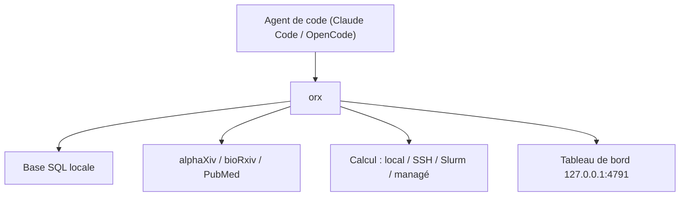

# alphaXiv/openresearch-cli

> Espace de travail local pour agents de recherche, qui garde la mémoire de chaque expérience.

## Le problème
Les agents qui lancent des expériences oublient les résultats passés et ne les relient pas à la littérature.

## Ce que ça fait vraiment
Fonctionne avec ton agent de code (Claude Code, ou un modèle local via OpenCode). Enregistre chaque expérience dans une base SQL locale, avec logs, code et artefacts sur ta machine. Se relie à alphaXiv, bioRxiv et PubMed pour fonder les hypothèses. Exécute en local, par SSH, Slurm ou sur calcul managé. Tableau de bord local sur le port 4791.

## Comment c'est branché

Schéma simplifié d'après le README ; aucun diagramme fourni.

## Essayer
```sh
curl -LsSf https://openresearch.sh/install.sh | sh
orx up
orx telemetry off
```

## Coût et pièges
Local et gratuit, mais un compte est nécessaire pour le calcul managé. Le binaire d'`install.sh` n'est pas signé et peut être bloqué sur un Mac géré : utiliser l'application de bureau. L'agent de code reste à ta charge.

## Ce que ce n'est pas
Pas un agent en soi. Les versions officielles envoient des statistiques d'usage et des retours détaillés de l'agent, avec un identifiant d'installation aléatoire ; désactivables.

## Alternatives
Aucune alternative nommée dans le README.

## Pour toi
À surveiller : l'idée d'une mémoire d'expériences locale et liée à la littérature sert bien un profil recherche/ML, mais le projet est récent (créé en juin 2026) et envoie de la télémétrie par défaut.

