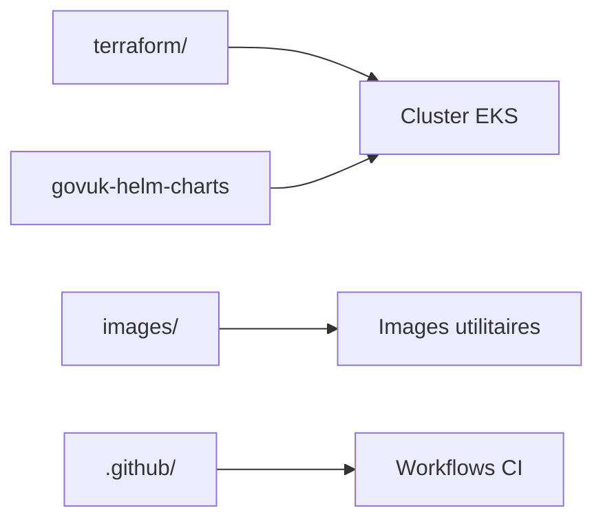

# alphagov/govuk-infrastructure

> Infrastructure code of the GOV.UK site: Terraform modules for an EKS cluster, utility images and CI workflows.

## The problem
Running GOV.UK on Kubernetes requires Terraform modules, images and CI automations that are consistent and shared across repositories.

## What it actually does
The repository contains `terraform/` (modules to set up a Kubernetes cluster on EKS), `images/` (definitions of utility container images) and `.github/` (actions and workflows for release, tests, security analysis). The Helm charts and the CDN configuration are in other repositories.

## How it is wired


## Trying it
```bash
brew install tfenv
cd terraform/
tfenv install latest
tfenv use latest
make lint_docs
```

## Cost and gotchas
Terraform pins minor versions; the full version must be specified with tfenv. An AWS account is required to use EKS (not detailed). Vale is required for documentation linting.

## What it is not
Not a reusable product: it is the infrastructure of a specific organization. The Helm charts, the CDN and the analytics GCP are elsewhere.

## Alternatives
No alternative named in the README.

## For you
Ignore: only useful as an example of Terraform/EKS at the scale of a state, not as a building block to adopt.
