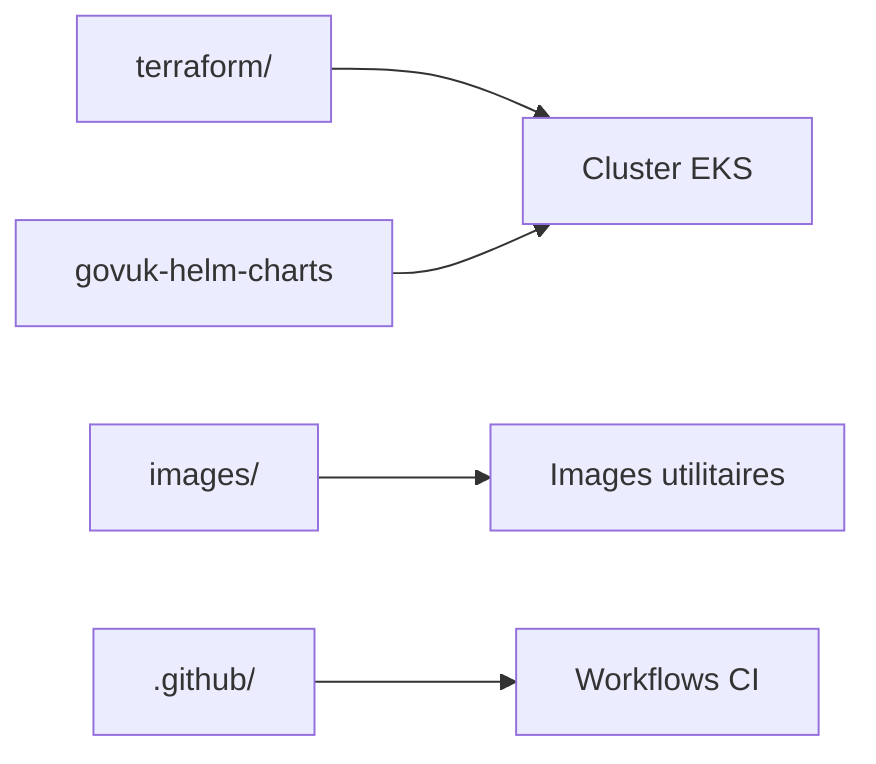

# alphagov/govuk-infrastructure

> Code d'infrastructure du site GOV.UK : modules Terraform pour un cluster EKS, images utilitaires et workflows CI.

## Le problème
Faire tourner GOV.UK sur Kubernetes demande des modules Terraform, des images et des automatisations CI cohérents et partagés entre dépôts.

## Ce que ça fait vraiment
Le dépôt contient `terraform/` (modules pour monter un cluster Kubernetes sur EKS), `images/` (définitions d'images de conteneurs utilitaires) et `.github/` (actions et workflows de release, tests, analyse de sécurité). Les charts Helm et la configuration du CDN sont dans d'autres dépôts.

## Comment c'est branché


## Essayer
```bash
brew install tfenv
cd terraform/
tfenv install latest
tfenv use latest
make lint_docs
```

## Coût et pièges
Terraform en pointant des versions mineures ; il faut préciser la version complète avec tfenv. Un compte AWS est nécessaire pour utiliser EKS (non détaillé). Vale est requis pour le linting de la documentation.

## Ce que ce n'est pas
Pas un produit réutilisable : c'est l'infrastructure d'une organisation précise. Les charts Helm, le CDN et le GCP analytique sont ailleurs.

## Alternatives
Aucune alternative nommée dans le README.

## Pour toi
À ignorer : utile seulement comme exemple de Terraform/EKS à l'échelle d'un État, pas comme brique à adopter.

