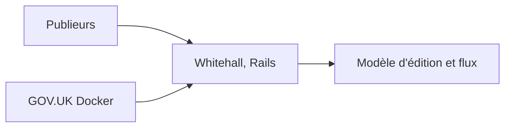

# alphagov/whitehall

> Rails application used by GOV.UK publishers to create and manage content.

## The problem
UK government services need a controlled publishing tool, with a document lifecycle.

## What it actually does
Whitehall, also called Whitehall Admin or Whitehall Publisher, lets you create and manage published content. The README says nothing more: the details are in the `docs/` folder (publishing model, publishing flow, audit trail, internationalisation, JavaScript). The internal workings are undocumented here.

## How it is wired
Simplified diagram based on the sheet, no diagram provided.



## Trying it
```bash
govuk-docker-run bundle exec rake
govuk-docker-run bundle exec rake jasmine
```
These commands assume the GOV.UK Docker environment is already in place.

## Cost and gotchas
Free. You need the GOV.UK Docker environment and its dependencies; it is not designed to be deployed on its own.

## What it is not
Not a general-purpose, ready-to-install CMS: it serves the GOV.UK ecosystem. It is not designed as a reusable product.

## Alternatives
No alternative named in the README.

## For you
Ignore: a business application specific to GOV.UK, of no direct interest to a data, AI or MLOps profile.
