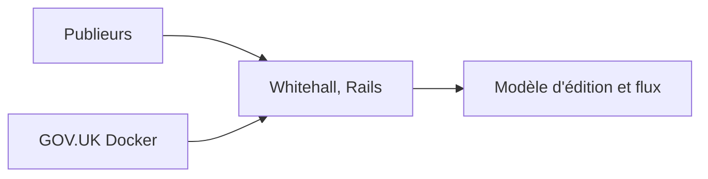

# alphagov/whitehall

> Application Rails utilisée par les publieurs de GOV.UK pour créer et gérer du contenu.

## Le problème
Les services de l'État britannique ont besoin d'un outil de publication encadré, avec cycle de vie des documents.

## Ce que ça fait vraiment
Whitehall, aussi nommé Whitehall Admin ou Whitehall Publisher, permet de créer et gérer le contenu publié. Le README n'en dit pas plus : le détail se trouve dans le dossier `docs/` (modèle d'édition, flux d'édition, piste d'audit, internationalisation, JavaScript). Le fonctionnement interne est non documenté ici.

## Comment c'est branché
Schéma simplifié d'après la fiche, sans diagramme fourni.



## Essayer
```bash
govuk-docker-run bundle exec rake
govuk-docker-run bundle exec rake jasmine
```
Ces commandes supposent l'environnement GOV.UK Docker déjà en place.

## Coût et pièges
Gratuit. Il faut l'environnement GOV.UK Docker et ses dépendances ; il n'est pas pensé pour être déployé seul.

## Ce que ce n'est pas
Pas un CMS généraliste prêt à installer : il sert l'écosystème GOV.UK. Il n'est pas conçu comme produit réutilisable.

## Alternatives
Aucune alternative nommée dans le README.

## Pour toi
À ignorer : application métier propre à GOV.UK, sans intérêt direct pour un profil data, IA ou MLOps.

