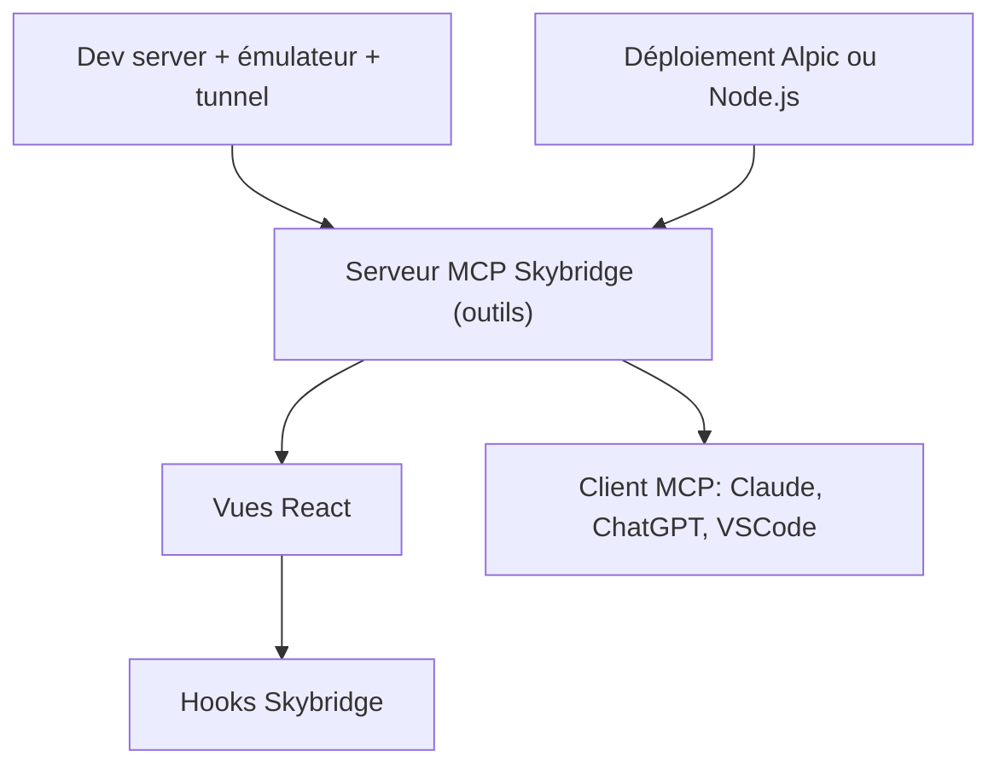

# alpic-ai/skybridge

> React framework and server for building MCP apps with a user interface, in Claude, ChatGPT and elsewhere.

## The problem
Raw MCP SDKs are low-level: no hooks, little end-to-end typing, no hot reload. MCP clients differ from one another.

## What it actually does
Skybridge provides a development server with a local emulator, hot reload and a permanent tunnel. Typing runs from the MCP server's tool definition all the way to the React view. It offers React Query-style hooks and a library of examples (e-commerce, travel, authentication).

## How it is wired
Simplified diagram based on the sheet, no diagram provided.



## Trying it
```bash
npm create skybridge@latest my-app
npx skills add alpic-ai/skybridge -s skybridge
```

## Cost and gotchas
The framework is free. Deployment on Alpic (hosting, analytics, permanent tunnel) is a service from the publisher; self-hosting on Node.js remains possible.

## What it is not
Not a generic MCP client or server: it targets MCP apps with a rich interface. It does not replace understanding the MCP protocol.

## Alternatives
No alternative named in the README, apart from the raw SDKs, judged low-level.

## For you
Watch if you expose AI tools to users via Claude or ChatGPT: end-to-end typing and hot reload save glue code.
