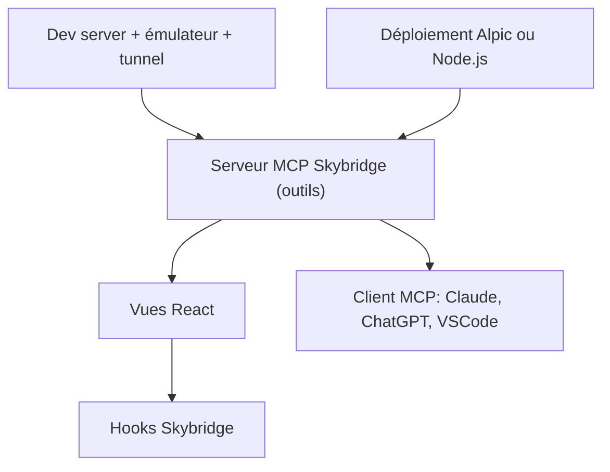

# alpic-ai/skybridge

> Framework React et serveur pour construire des applications MCP avec interface, dans Claude, ChatGPT et ailleurs.

## Le problème
Les SDK MCP bruts sont de bas niveau : pas de hooks, peu de typage de bout en bout, pas de rechargement à chaud. Les clients MCP diffèrent entre eux.

## Ce que ça fait vraiment
Skybridge fournit un serveur de développement avec émulateur local, rechargement à chaud et tunnel permanent. Le typage va de la définition d'outil du serveur MCP jusqu'à la vue React. Il propose des hooks de type React Query et une bibliothèque d'exemples (e-commerce, voyage, authentification).

## Comment c'est branché
Schéma simplifié d'après la fiche, sans diagramme fourni.



## Essayer
```bash
npm create skybridge@latest my-app
npx skills add alpic-ai/skybridge -s skybridge
```

## Coût et pièges
Le framework est gratuit. Le déploiement sur Alpic (hébergement, analytics, tunnel permanent) est un service de l'éditeur ; l'auto-hébergement sur Node.js reste possible.

## Ce que ce n'est pas
Ce n'est pas un client ni un serveur MCP générique : il vise les apps MCP avec interface riche. Il ne remplace pas la compréhension du protocole MCP.

## Alternatives
Aucune alternative nommée dans le README, hors les SDK bruts, jugés de bas niveau.

## Pour toi
À surveiller si tu exposes des outils d'IA à des utilisateurs via Claude ou ChatGPT : le typage de bout en bout et le rechargement à chaud évitent du code de liaison.

