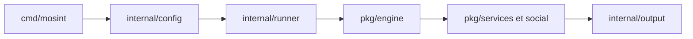

# alpkeskin/mosint

> Go command-line tool that aggregates open sources around an e-mail address.

## The problem
Checking what is public around an address (leaks, accounts, linked domains) means querying several services separately.

## What it actually does
Starting from an address, Mosint runs in parallel modules that query external services: e-mail verification, data and password leaks (Intelligence X, BreachDirectory, HaveIBeenPwned), Pastebin dumps, linked e-mails and domains (hunter.io), IP/DNS information, Google search and presence on social networks (Twitter, Instagram, Spotify). Everything is consolidated in the console or as JSON. API keys are declared in `$HOME/.mosint.yaml`.

## How it is wired


## Trying it
```bash
go install -v github.com/alpkeskin/mosint/v3/cmd/mosint@latest
mosint example@email.com
mosint -h
docker build -t mosint .
docker run mosint --help
```
The README requires a configuration file (`--config` for another location).

## Cost and gotchas
The software is free, but several services require an API key, sometimes paid. The scylla.so service is marked as under construction. Last push in February 2024: some integrations may have stopped working. Investigating a person without a legal basis may fall under the GDPR: reserve it for addresses you have the right to investigate (your own, an authorized audit scope).

## What it is not
It is not a data source: it is an aggregator of third-party services, on which it depends. It guarantees neither completeness nor accuracy.

## Alternatives
- HaveIBeenPwned: service cited by the README, for checking leaks of your own addresses only.

## For you
Keep an eye on it: e-mail OSINT outside the data/AI core, with dormant maintenance; useful only for an exposure audit of your own addresses.
