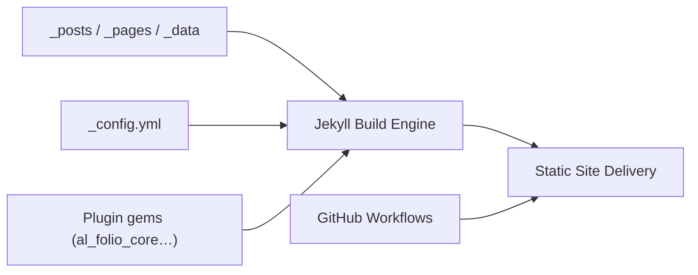

# alshedivat/al-folio

> Jekyll template for an academic website: publications, CV, blog, for researchers.

## The problem
A researcher wants a clean site (BibTeX publications, CV, posts) without building it from scratch.

## What it actually does
A "thin" Jekyll starter in v1.x: the runtime comes from versioned plugin gems (core, cv, distill, math, charts, search, citations, analytics, comments...). Pages are driven by data files. Agent skills (Codex, Claude) help with configuration and migration.

## How it is wired


## Trying it
```bash
bundle exec al-folio upgrade overrides audit
```
To get started, the README points to docs/QUICKSTART.md and uses "Use this template".

## Cost and gotchas
Free; can be hosted on GitHub Pages. Comments, analytics and newsletter require keys.

## What it is not
Not a theme to merge: in v1.x it is a starter plus plugins. Features marked "setup" are inactive without configuration.

## Alternatives
No alternative named in the README.

## For you
Ignore unless you want a publications site: useful for displaying papers and a CV, unrelated to data work.
