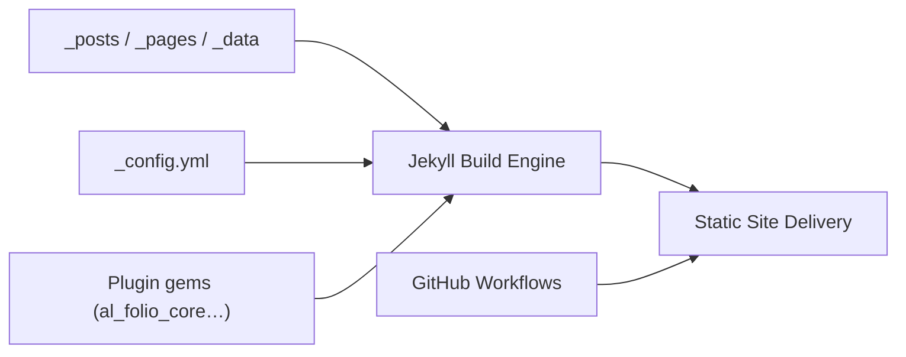

# alshedivat/al-folio

> Gabarit Jekyll de site académique : publications, CV, blog, pour chercheurs.

## Le problème
Un chercheur veut un site propre (publications BibTeX, CV, billets) sans le construire de zéro.

## Ce que ça fait vraiment
Démarreur Jekyll « mince » en v1.x : le runtime vient de plugins gems versionnés (core, cv, distill, math, charts, recherche, citations, analytics, commentaires…). Les pages se pilotent par des fichiers de données. Des skills d'agents (Codex, Claude) aident à configurer et migrer.

## Comment c'est branché


## Essayer
```bash
bundle exec al-folio upgrade overrides audit
```
Pour démarrer, le README renvoie à docs/QUICKSTART.md et utilise « Use this template ».

## Coût et pièges
Gratuit ; hébergement possible sur GitHub Pages. Commentaires, analytics et newsletter exigent des clés.

## Ce que ce n'est pas
Pas un thème à fusionner : en v1.x c'est un démarreur plus des plugins. Fonctions marquées « setup » inactives sans configuration.

## Alternatives
Aucune alternative nommée dans le README.

## Pour toi
À ignorer sauf si tu veux un site de publications : utile pour afficher articles et CV, sans lien avec le travail data.

