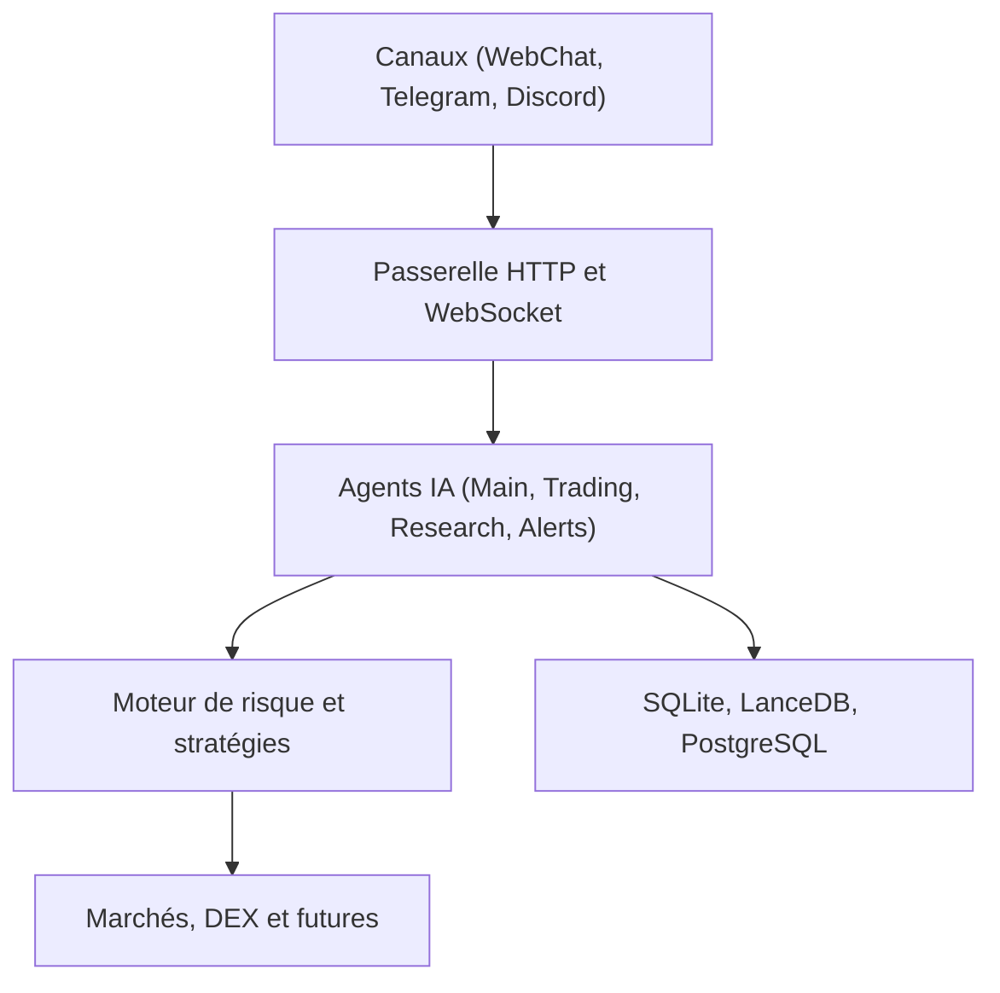

# alsk1992/CloddsBot

> Claude-assisted trading terminal for prediction markets, crypto and futures, via messaging apps.

## The problem
Tracking and executing positions across many markets and platforms requires many separate tools.

## What it actually does
A local gateway (SQLite, LanceDB) connects messaging channels (Telegram, Discord, WebChat) to LLM agents, with skills, arbitrage detection, copy trading, DCA bots, a decision journal and an MCP server. It places orders on several prediction, futures and DeFi platforms, and exposes an agent marketplace, token launches and a paid compute API.

## How it is wired


## Trying it
```bash
npm install -g https://github.com/alsk1992/CloddsBot/releases/latest/download/clodds.tgz --loglevel=error
clodds onboard
clodds start
```

## Cost and gotchas
Node.js 22 or later, an ANTHROPIC_API_KEY and platform keys. Private wallet keys must be supplied (SOLANA_PRIVATE_KEY). Leverage up to 200x: real losses are possible. The README shows a token address and paid services in USDC.

## What it is not
Not a financial advisor nor an audited tool: a hackathon project built in 12 days according to the README. The default arbitrage mode is "dry-run".

## Alternatives
Not documented in the README.

## For you
Ignore: it handles real keys and money, it is young and mixes several paid offerings; too risky for professional use.
