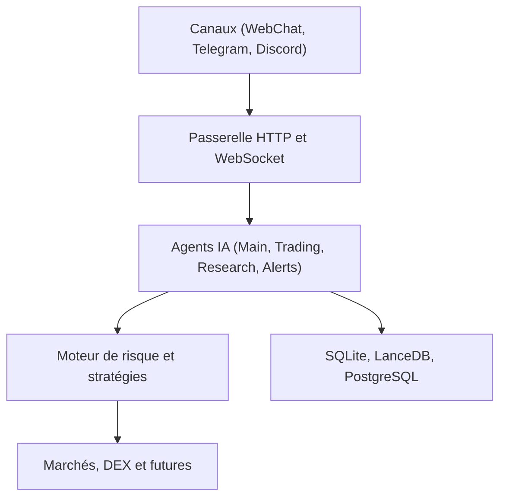

# alsk1992/CloddsBot

> Terminal de trading assisté par Claude pour marchés de prédiction, crypto et contrats à terme, via messageries.

## Le problème
Suivre et exécuter des positions sur de nombreux marchés et plateformes demande beaucoup d'outils séparés.

## Ce que ça fait vraiment
Une passerelle locale (SQLite, LanceDB) relie des canaux de messagerie (Telegram, Discord, WebChat) à des agents LLM, avec compétences, détection d'arbitrage, copy trading, bots DCA, journal de décisions et serveur MCP. Il passe des ordres sur plusieurs plateformes de prédiction, de futures et de DeFi, et expose une place de marché d'agents, des lancements de jetons et une API de calcul payante.

## Comment c'est branché


## Essayer
```bash
npm install -g https://github.com/alsk1992/CloddsBot/releases/latest/download/clodds.tgz --loglevel=error
clodds onboard
clodds start
```

## Coût et pièges
Node.js 22 ou plus, clé ANTHROPIC_API_KEY et clés de plateformes. Des clés privées de portefeuille sont à fournir (SOLANA_PRIVATE_KEY). Effet de levier jusqu'à 200x : pertes réelles possibles. Le README affiche une adresse de jeton et des services payants en USDC.

## Ce que ce n'est pas
Pas un conseiller financier ni un outil audité : projet de hackathon développé en 12 jours selon le README. Le mode par défaut de l'arbitrage est « dry-run ».

## Alternatives
Non documenté dans le README.

## Pour toi
À ignorer : il manipule de vraies clés et de l'argent, il est jeune et mêle plusieurs offres payantes ; trop risqué pour un usage professionnel.

