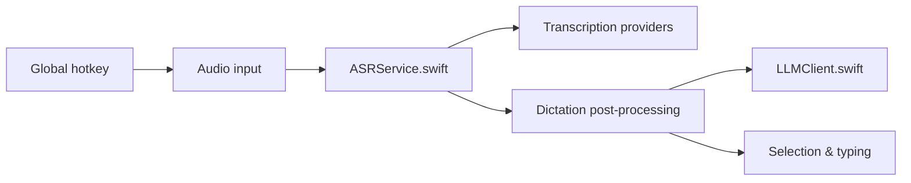

# altic-dev/FluidVoice

> Local voice dictation app for macOS with optional AI enhancement and voice commands.

## The problem
Dictation apps often send the audio to the cloud and integrate poorly with every application.

## What it actually does
Global hotkey, local transcription (Parakeet, Nemotron, Whisper, Apple Speech, Cohere Transcribe) with a live preview around the notch.
Inserts the text into any app through accessibility; Write mode (rewrite a selection), Command mode (control the Mac).
Post-processing by OpenAI, Groq, a custom provider or a local "Fluid Intelligence" (private engine, not open source).
Local audio history, per-application prompts, local HTTP API.

## How it is wired


## Trying it
```bash
brew install --cask fluidvoice
git clone https://github.com/altic-dev/FluidVoice.git
cd FluidVoice
./build.sh
```

## Cost and gotchas
Free; macOS 15+, Apple Silicon for all models, ~1 GB per model and 3.5 GB for Fluid Intelligence.
Telemetry: a weekly activity signal is always sent, detailed analytics are enabled by default.

## What it is not
Not entirely open source: Fluid Intelligence is private.
Neither Linux nor Windows for now.

## Alternatives
No alternative named in the README.

## For you
Worth watching as a personal productivity tool on Mac; the default telemetry and the private engine prevent recommending it without reservation.
