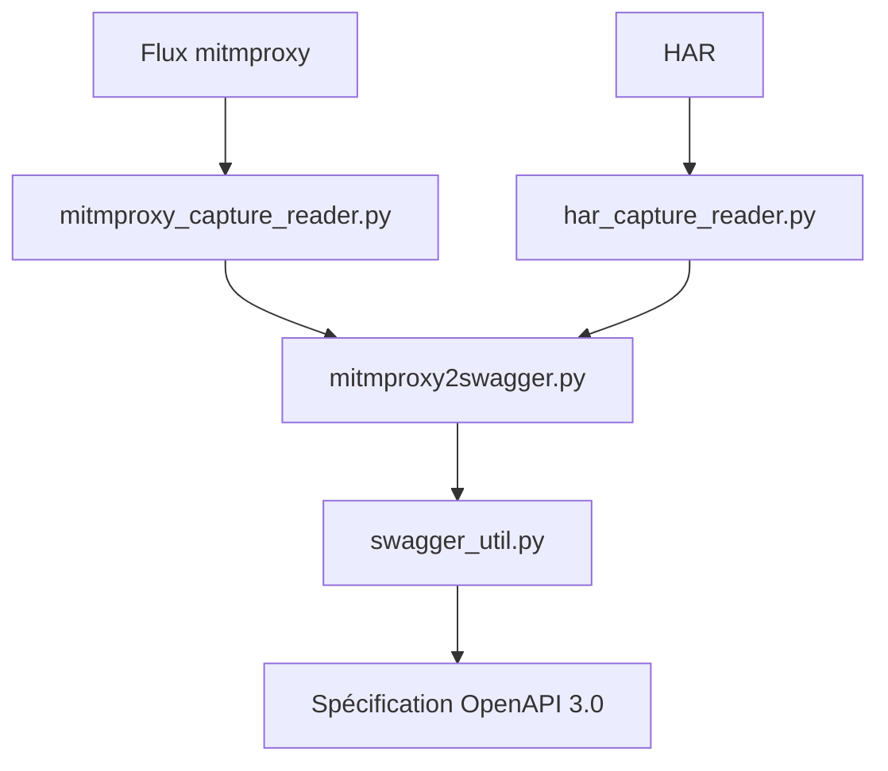

# alufers/mitmproxy2swagger

> Converts mitmproxy or HAR captures into an OpenAPI 3.0 specification, for reverse-engineering REST APIs.

## The problem
Documenting a REST API you do not control means reading the traffic by hand.

## What it actually does
Reads a mitmproxy flow file or a HAR exported from DevTools. A first pass writes `x-path-templates` path templates prefixed with `ignore:`; you remove the prefix from the paths you want; a second pass generates the descriptions. `--examples` and `--headers` add data, sometimes sensitive.

## How it is wired


## Trying it
```bash
pip install mitmproxy2swagger
mitmweb
mitmproxy2swagger -i <path_to_mitmptoxy_flow> -o <path_to_output_schema> -p <api_prefix>
mitmproxy2swagger -i <path_to_mitmptoxy_flow> -o <path_to_output_schema> -p <api_prefix> --examples
```

## Cost and gotchas
Free. Python 3 and pip required. The `--examples` and `--headers` options may copy tokens, passwords and personal data into the spec. No license declared.

## What it is not
Not automatic: you have to edit the file between the two passes. The diagram provided is in Chinese and also covers tests and configuration.

## Alternatives
No alternative named in the README.

## For you
Keep an eye on it: useful for documenting a third-party API you integrate into a pipeline, but the missing license must be clarified before any use in a company.
