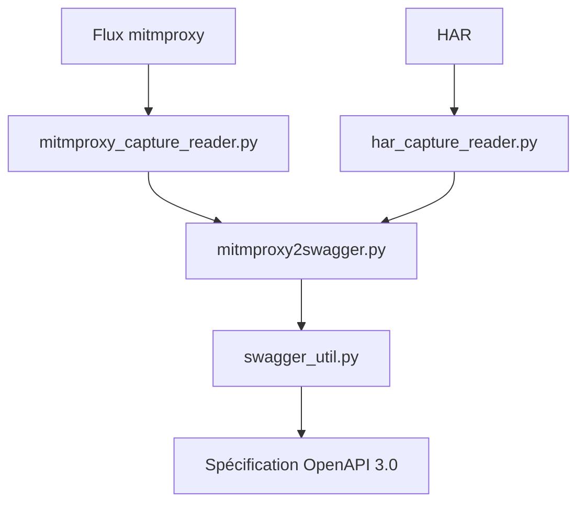

# alufers/mitmproxy2swagger

> Convertit des captures mitmproxy ou HAR en spécification OpenAPI 3.0, pour rétro-ingénierie d'API REST.

## Le problème
Documenter une API REST qu'on ne maîtrise pas oblige à lire le trafic à la main.

## Ce que ça fait vraiment
Lit un fichier de flux mitmproxy ou un HAR exporté des DevTools. Une première passe écrit des modèles de chemins `x-path-templates` préfixés `ignore:`; on retire le préfixe des chemins voulus ; une seconde passe génère les descriptions. `--examples` et `--headers` ajoutent des données, parfois sensibles.

## Comment c'est branché


## Essayer
```bash
pip install mitmproxy2swagger
mitmweb
mitmproxy2swagger -i <path_to_mitmptoxy_flow> -o <path_to_output_schema> -p <api_prefix>
mitmproxy2swagger -i <path_to_mitmptoxy_flow> -o <path_to_output_schema> -p <api_prefix> --examples
```

## Coût et pièges
Gratuit. Python 3 et pip requis. Les options `--examples` et `--headers` peuvent copier jetons, mots de passe, données personnelles dans la spec. Aucune licence déclarée.

## Ce que ce n'est pas
Pas automatique : il faut éditer le fichier entre les deux passes. Le diagramme fourni est en chinois et décrit aussi tests et configuration.

## Alternatives
Aucune alternative nommée dans le README.

## Pour toi
À surveiller : utile pour documenter une API tierce que tu intègres à un pipeline, mais absence de licence à clarifier avant tout usage en entreprise.

