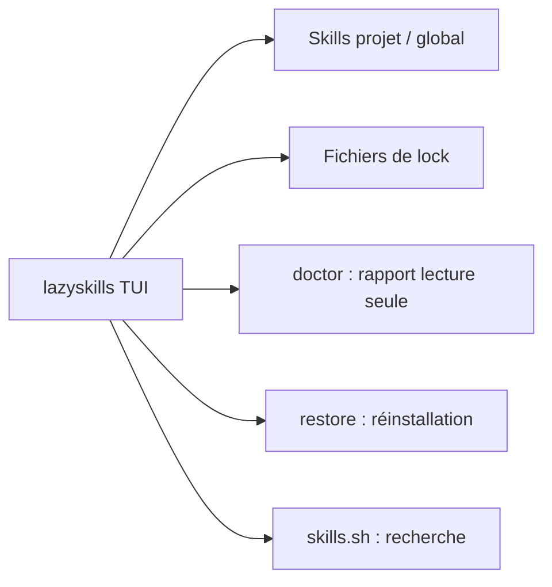

# alvinunreal/lazyskills

> Terminal interface that inventories installed agent skills and diagnoses those that are broken or invisible.

## The problem
Skills are scattered across project, global and per-agent folders; a broken installation (missing SKILL.md, dead link) stays invisible until it fails.

## What it actually does
Lists all skills in a TUI, shows which ones each agent can use (Claude Code, OpenCode, Codex, Cursor, Gemini CLI…) and flags invalid frontmatter, broken symlinks and missing lock entries. Previews the command before opening, reinstalling, deleting or purging, with confirmation. `doctor` produces a read-only report, `restore` reinstalls from lock files, `find` queries skills.sh.

## How it is wired


## Trying it
```bash
curl -fsSL https://lazyskills.sh/install | sh
brew install --cask alvinunreal/tap/lazyskills
go install github.com/alvinunreal/lazyskills/cmd/lazyskills@latest
lazyskills
lazyskills doctor --json
lazyskills restore --project --yes
lazyskills find --json "browser automation"
```

## Cost and gotchas
Free. Installing via `curl | sh` runs a remote script; prefer Homebrew or `go install` if you want more control. `restore` rescans before each installation, but the README admits it does not eliminate every race with concurrent installations.

## What it is not
Not a proper package manager: it relies on skills.sh and its installation commands. `doctor` changes nothing.

## Alternatives
No alternative named in the README.

## For you
Adopt it if you accumulate skills for several agents: the read-only `doctor` saves time on broken installations, with no risk.
