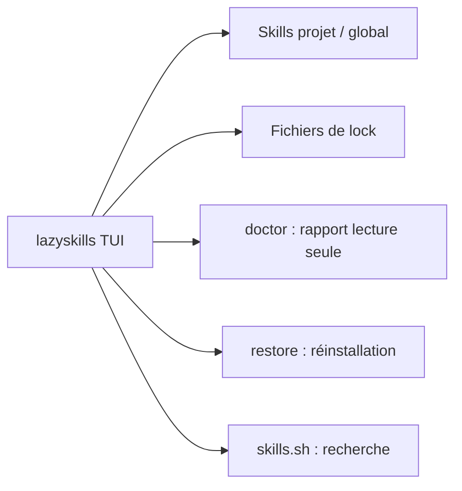

# alvinunreal/lazyskills

> Interface terminal qui inventorie les skills d'agents installés et diagnostique ceux qui sont cassés ou invisibles.

## Le problème
Les skills sont dispersés entre projet, global et dossiers par agent ; une installation cassée (SKILL.md absent, lien mort) reste invisible jusqu'à l'échec.

## Ce que ça fait vraiment
Liste tous les skills dans une TUI, montre lesquels sont utilisables par chaque agent (Claude Code, OpenCode, Codex, Cursor, Gemini CLI…) et signale frontmatter invalide, liens symboliques cassés, entrées de lock manquantes. Prévisualise la commande avant ouverture, réinstallation, suppression ou purge, avec confirmation. `doctor` produit un rapport en lecture seule, `restore` réinstalle depuis les fichiers de lock, `find` interroge skills.sh.

## Comment c'est branché


## Essayer
```bash
curl -fsSL https://lazyskills.sh/install | sh
brew install --cask alvinunreal/tap/lazyskills
go install github.com/alvinunreal/lazyskills/cmd/lazyskills@latest
lazyskills
lazyskills doctor --json
lazyskills restore --project --yes
lazyskills find --json "browser automation"
```

## Coût et pièges
Gratuit. L'installation par `curl | sh` exécute un script distant ; préfère Homebrew ou `go install` si tu veux plus de contrôle. `restore` rescanne avant chaque installation, mais le README admet qu'il ne supprime pas toutes les courses avec des installations concurrentes.

## Ce que ce n'est pas
Pas un gestionnaire de paquets propre : il s'appuie sur skills.sh et ses commandes d'installation. `doctor` ne modifie rien.

## Alternatives
Aucune alternative nommée dans le README.

## Pour toi
À adopter si tu accumules des skills pour plusieurs agents : `doctor` en lecture seule fait gagner du temps sur les installations cassées, sans risque.

