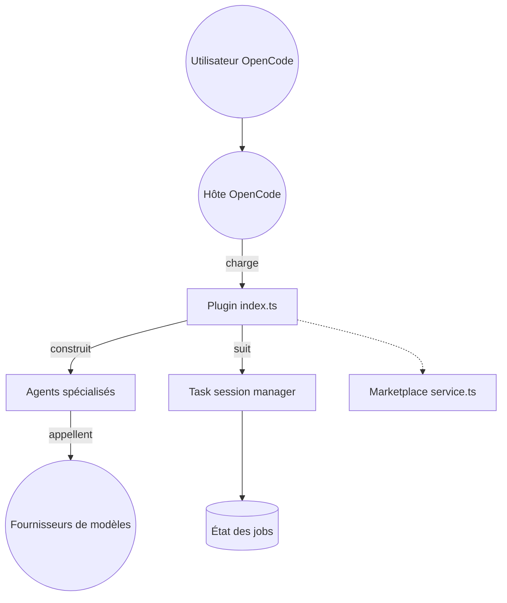

# alvinunreal/oh-my-opencode-slim

> OpenCode plugin that splits a coding task across specialized agents, for OpenCode users.

## The problem
A single model does everything, too expensive or too slow depending on the task. Planning, exploring, reviewing and coding call for different models.

## What it actually does
An orchestrator plans and launches agents (explorer, oracle, designer, fixer) as background tasks, then reconciles their results. Each agent has its own model, set in `oh-my-opencode-slim.json` through presets. It adds a multi-model council, skills, an agent marketplace and tmux/zellij panes.

## How it is wired


## Trying it
```bash
bunx oh-my-opencode-slim@latest install
opencode auth login
opencode models --refresh
```

## Cost and gotchas
Models are billed by your providers; the council runs several models in parallel, so it is the most expensive item. The presets in the README age quickly.

## What it is not
Not an independent autonomous agent: it only exists on top of OpenCode. The models cited in the presets are examples, not stable recommendations.

## Alternatives
- ACP Agents (documented in the README): to delegate to Claude Code as a sub-agent.
- OmniRoute (cited): if the need is mainly routing between providers.

## For you
Worth watching: useful if you already use OpenCode with several models, but dependent on a single maintainer and a fast-moving host.
