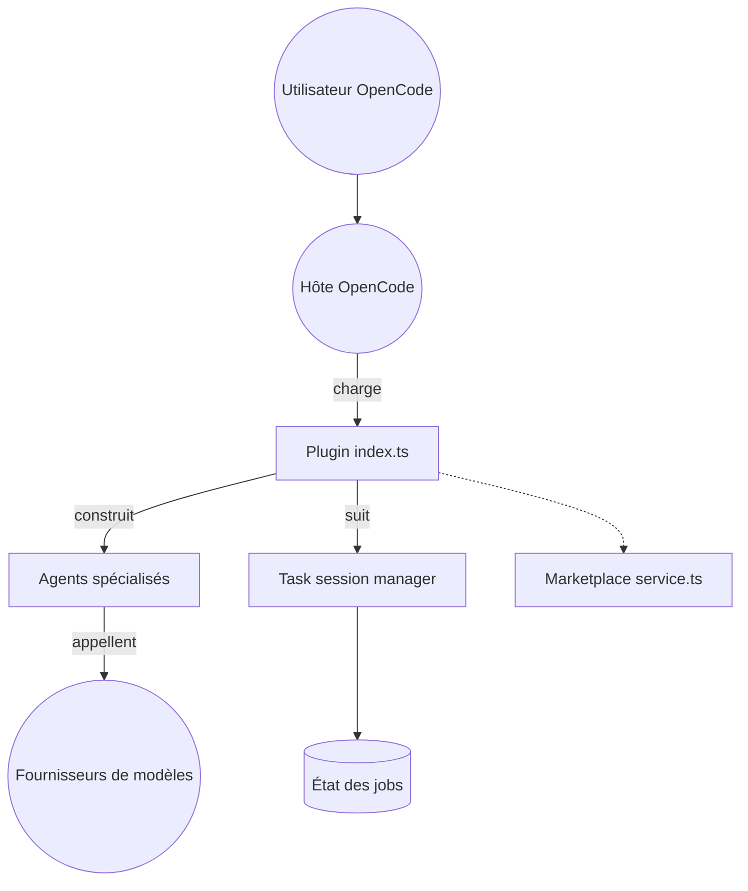

# alvinunreal/oh-my-opencode-slim

> Plugin OpenCode qui répartit une tâche de code entre agents spécialisés, pour les utilisateurs d'OpenCode.

## Le problème
Un seul modèle fait tout, trop cher ou trop lent selon la tâche. Planifier, explorer, relire et coder demandent des modèles différents.

## Ce que ça fait vraiment
Un orchestrateur planifie et lance des agents (explorer, oracle, designer, fixer) en tâches de fond, puis réconcilie leurs résultats. Chaque agent a son modèle, réglé dans `oh-my-opencode-slim.json` via des presets. Il ajoute un conseil multi-modèles (council), des skills, un marketplace d'agents et des panneaux tmux/zellij.

## Comment c'est branché


## Essayer
```bash
bunx oh-my-opencode-slim@latest install
opencode auth login
opencode models --refresh
```

## Coût et pièges
Les modèles sont facturés par tes fournisseurs ; le council lance plusieurs modèles en parallèle, donc le poste le plus coûteux. Les presets du README vieillissent vite.

## Ce que ce n'est pas
Pas un agent autonome indépendant : il n'existe qu'au-dessus d'OpenCode. Les modèles cités dans les presets sont des exemples, pas des recommandations stables.

## Alternatives
- ACP Agents (documenté dans le README) : pour déléguer à Claude Code comme sous-agent.
- OmniRoute (cité) : si le besoin est surtout un routage entre fournisseurs.

## Pour toi
À surveiller : utile si tu utilises déjà OpenCode avec plusieurs modèles, mais dépendant d'un seul mainteneur et d'un hôte qui évolue vite.

