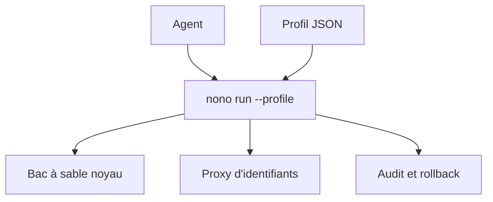

# always-further/nono

> Exécution d'agents IA dans un bac à sable noyau, avec identifiants, réseau et audit contrôlés.

## Le problème
Un agent qui lance des outils peut lire des fichiers, voler des clés ou sortir sur le réseau sans garde-fou.

## Ce que ça fait vraiment
Un binaire unique, sans droits root, isole chaque outil dans un bac à sable (fichiers, réseau, variables, identifiants). Les clés restent hors de l'agent, injectées par proxy. Le réseau est filtré par domaine, méthode et chemin. Il vérifie les compétences par Sigstore, tient un audit signé et restaure des fichiers depuis des instantanés. Profils JSON composables.

## Comment c'est branché
Schéma simplifié d'après la fiche, sans diagramme fourni.


## Essayer
```bash
curl -fsSL https://nono.sh/install.sh | sh
brew install nono
nono search pi
nono pull nolabs-ai/pi
nono run --profile nolabs-ai/pi -- pi
```

## Coût et pièges
Gratuit. L'API change encore avant la 1.0. Windows uniquement via WSL2.

## Ce que ce n'est pas
Pas un antivirus ni un pare-feu général : il protège ce qui tourne sous nono. Une politique mal écrite laisse des accès.

## Alternatives
Aucune alternative nommée dans le README.

## Pour toi
À adopter : cadrer un agent de code qui touche tes clés d'API et tes données est un besoin réel, et l'outil est léger.

