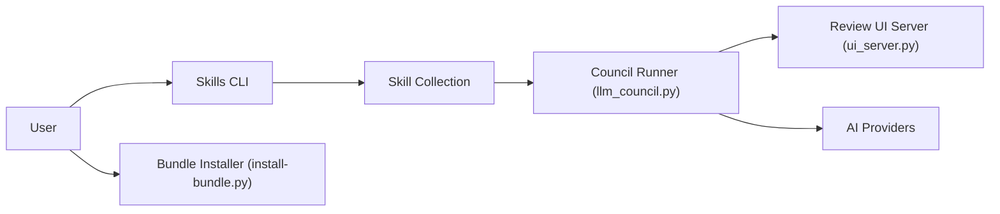

# am-will/codex-skills

> Collection of skills, agents and hooks for Codex and other coding agents, installable via `npx skills`.

## The problem
Reusing planning, documentation access and browser automation across agents means copying instructions by hand.

## What it actually does
A skills repository: `planner`, `plan-harder`, `parallel-task` (parallel sub-agents), `llm-council` (several Claude/Codex/Gemini planners judged by an agent, with a web interface), documentation (Context7, OpenAI docs, gitmcp.io), a GPT-5.6 prompt builder, frontend design, two browser tools. It also contains 51 Codex hook bundles and specialized TOML agents.

## How it is wired


## Trying it
```bash
npx skills add am-will/codex-skills --list
npx skills add am-will/codex-skills --skill planner -g
python3 hooks/aitmpl-codex/install-bundle.py hooks/aitmpl-codex/<category>/<bundle> <target-repo>
```

## Cost and gotchas
`ctx7old` requires `CONTEXT7_API_KEY`, `gemini-computer-use` requires `GEMINI_API_KEY`, `llm-council` requires Anthropic, OpenAI and Google keys or subscriptions. No license declared, even though some skills are imported from Anthropic and Vercel.

## What it is not
It is not a framework: it is a catalogue of prompt and configuration files. The quality of each skill is not assessed in the README.

## Alternatives
No alternative named in the README.

## For you
Worth watching: a useful source for `planner` or `parallel-task`, but the absence of a license legally forbids reusing them without the author's permission.
