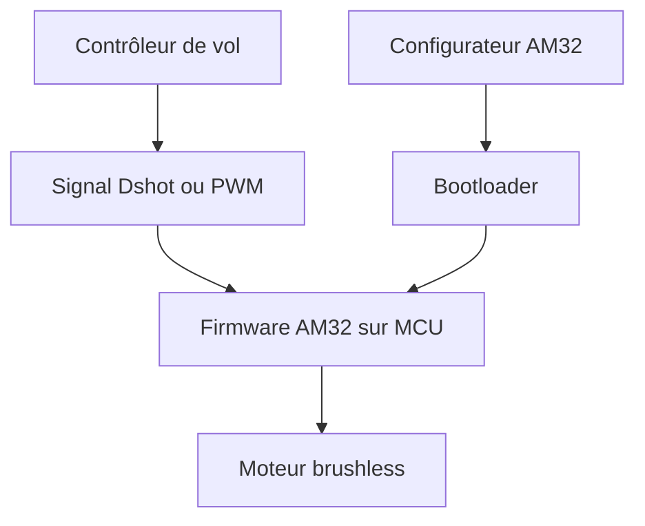

# am32-firmware/AM32

> Open-source firmware for brushless motor controllers on ARM microcontrollers, intended for drones and multirotors.

## The problem
Drone speed controllers (ESCs) often ship with closed firmware that is hard to update or tune.

## What it actually does
Drives a brushless motor on STM32 and compatible chips. Accepts Servo PWM and Dshot (300, 600) protocols, with bidirectional Dshot, KISS telemetry, variable PWM frequency and sinusoidal startup. Updates through Betaflight passthrough, single-wire serial link or Arduino. A web and desktop configurator sets the parameters.

## How it is wired
Simplified diagram based on the sheet, no diagram provided.

## Trying it
No command in the README: building goes through Keil (projects in the "Keil projects" folder), then a bootloader must be flashed with an ST-LINK, GD-LINK, CMSIS-DAP or AT-LINK.

## Cost and gotchas
Hardware required: a compatible ESC and a programmer. The README cites the Keil tool for compiling. GPL-3.0: copyleft.

## What it is not
It is not desktop software: it runs inside the speed controller. The CKS32F051 is discouraged by the README.

## Alternatives
No alternative named in the README.

## For you
Ignore for a data / AI / MLOps profile: this is embedded drone electronics, unrelated to your daily work.
