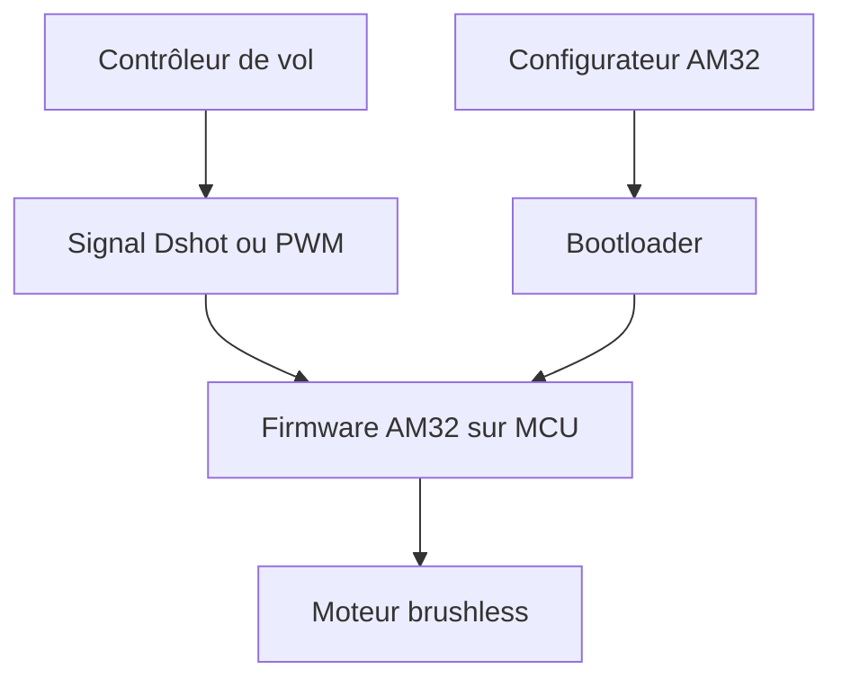

# am32-firmware/AM32

> Firmware libre pour variateurs de moteurs brushless sur microcontrôleurs ARM, destiné aux drones et multirotors.

## Le problème
Les variateurs (ESC) de drones embarquent souvent un firmware fermé, difficile à mettre à jour ou à régler.

## Ce que ça fait vraiment
Pilote un moteur brushless sur STM32 et puces compatibles. Accepte les protocoles Servo PWM et Dshot (300, 600), avec Dshot bidirectionnel, télémétrie KISS, fréquence PWM variable et démarrage sinusoïdal. Mise à jour via passthrough Betaflight, liaison série mono-fil ou Arduino. Un configurateur web et bureau règle les paramètres.

## Comment c'est branché
Schéma simplifié d'après la fiche, sans diagramme fourni.

## Essayer
Aucune commande dans le README : la compilation passe par Keil (projets du dossier « Keil projects »), puis un bootloader doit être posé avec un ST-LINK, GD-LINK, CMSIS-DAP ou AT-LINK.

## Coût et pièges
Matériel obligatoire : ESC compatible et programmateur. Le README cite l'outil Keil pour compiler. GPL-3.0 : copyleft.

## Ce que ce n'est pas
Ce n'est pas un logiciel pour ordinateur : il tourne dans le variateur. Le CKS32F051 est déconseillé par le README.

## Alternatives
Aucune alternative nommée dans le README.

## Pour toi
À ignorer pour un profil data / IA / MLOps : c'est de l'électronique embarquée de drone, sans rapport avec ton quotidien.

