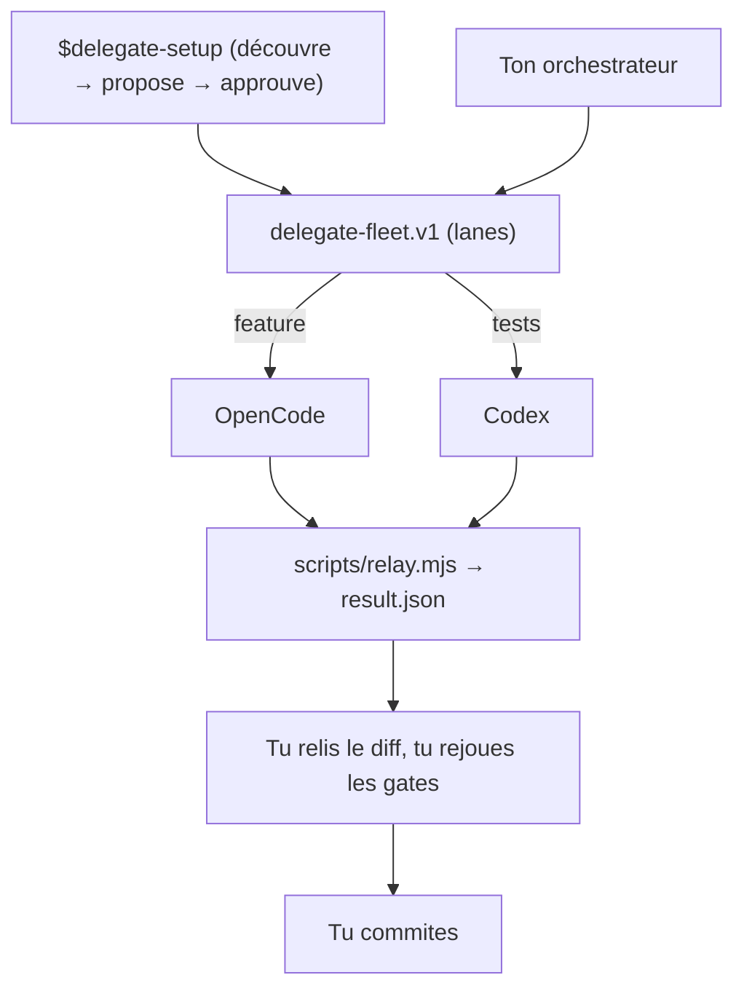

# amElnagdy/delegate-skills

> An orchestrator delegates to seventeen different coding CLIs; you review and commit.

## The problem
Each implementation CLI has its own autonomy flags, plan mode and session resumption: delegating a task to one and then to another means relearning everything.

## What it actually does
Provides one `*-delegate` skill per CLI (Aider, Antigravity, Claude Code, Cline, Codex, Command Code, Cursor Agent, Grok Build, Kimi, OpenCode, Pi, Oh My Pi, Qoder, Mistral Vibe, Copilot CLI, Warp `oz`, ZCode) plus a `delegate-setup` skill that discovers the installed CLIs and proposes a "fleet" of named lanes (`feature`, `tests`, `ui`), written only after explicit approval. Each relay speaks the same contract `delegate-relay.result.v1`: `status`, `exitCode`, `signal`, final report, `touchedFiles`, session identifier. The central table documents, CLI by CLI, default write access, read-only execution and resumption — including the cases where the CLI can guarantee nothing.

## How it is wired


## Trying it
```bash
npx skills add amElnagdy/delegate-skills
npx skills add amElnagdy/delegate-skills --list
npx skills add amElnagdy/delegate-skills --skill delegate-setup
npx skills add amElnagdy/delegate-skills --skill codex-delegate --agent claude-code
npx skills add amElnagdy/delegate-skills --global
```

## Cost and gotchas
Free; Node 18+, `git`, and each implementation CLI authenticated as in the terminal (so its own subscriptions). The footnotes are the essence: Command Code has only two states, `-p` without writing or `--yolo` with no path limit; Grok cannot be prevented from writing, the relay only reports it; Aider commits by default, including your uncommitted changes, and the relay forces `--no-auto-commits`/`--no-dirty-commits`; ZCode has no binary on the PATH. `touchedFiles` is an after-the-fact `git status`, not a guarantee: it does not see ignored files or writes outside the repository.

## What it is not
It is not a forwarder: the loop is dispatch → wait → review → commit, and the relay **never** commits. It is not an API wrapper — a real CLI edits a real working directory. No relay has a dependency, its own network access, credentials or telemetry: only Node primitives.

## Alternatives
- An editor's internal subagents or plugins, which coordinate within a single agent instead of keeping the contract portable across orchestrators.

## For you
Interesting if you want to run several paid CLIs in parallel without giving up the commit.
