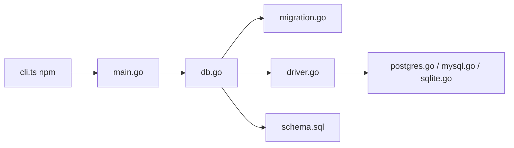

# amacneil/dbmate

> Language-independent SQL migration command-line tool, for multi-service teams.

## The problem
Keeping a database schema in sync between developers and production, especially when several services use different languages.

## What it actually does
A single binary applies timestamped SQL migrations, each in a transaction. It creates or drops databases, rolls back the last migration, waits for the database to become available and writes a `schema.sql` file to version. Supports MySQL, MariaDB, PostgreSQL, SQLite and ClickHouse; the README also documents BigQuery and Spanner (PostgreSQL). Usable as a Go library.

## How it is wired


## Trying it
```bash
npm install --save-dev dbmate
npx dbmate --help
dbmate new create_users_table
dbmate up
dbmate rollback
dbmate status
```

## Cost and gotchas
Free. The schema dump requires `pg_dump`, `mysqldump` or `sqlite3` in the PATH, otherwise the step is silently skipped. With Postgres, `sslmode=disable` is often needed locally.

## What it is not
Not an ORM or a migration generator: you write the SQL. It does not prevent applying migrations out of order if they come from different branches.

## Alternatives
- goose, sql-migrate, golang-migrate, flyway, sqitch: compared in the README table.

## For you
Adopt to version the schemas of your supporting databases (features, ML metadata): one binary, plain SQL, no language dependency.
