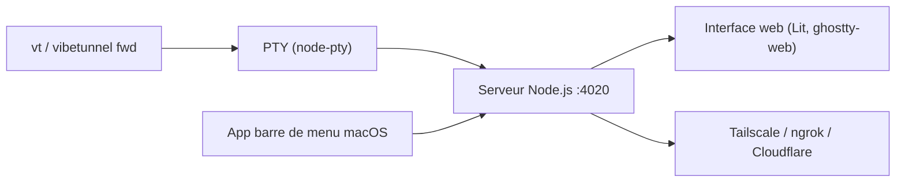

# amantus-ai/vibetunnel

> Proxy that exposes the terminals of a Mac or a server in the browser, to drive agents remotely.

## The problem
Monitoring an AI agent or a long build from a phone means setting up SSH and port forwarding.

## What it actually does
A Node.js server (Lit interface) streams terminal sessions to the browser via the `vt` command, with asciinema recording, activity indicators and a Git Follow mode. A macOS menu bar application manages the server. Remote access goes through Tailscale, ngrok, Cloudflare Quick Tunnel, Pinggy or Pangolin.

## How it is wired


## Trying it
```bash
npm install -g vibetunnel
vt pnpm run dev
vibetunnel --bind 0.0.0.0
npx -y vibetunnel --no-auth
```

## Cost and gotchas
Free; the macOS application requires an Apple Silicon Mac, the npm package requires Node 22.12 to 24.x, and Windows is not supported. Exposing a terminal on the network is risky: choose an authentication method, never use `--no-auth` outside a trusted network. Tailscale, ngrok and the others have their own accounts and plans.

## What it is not
It is not a secure-by-default SSH client nor a Windows solution. The iOS app is still under development, according to the README.

## Alternatives
Tailscale, ngrok, Cloudflare Quick Tunnel, Pinggy and Pangolin are cited as remote access means, not as competitors.

## For you
Worth watching: handy for following agents or long training runs from a phone, but it opens terminal access that requires careful authentication.
