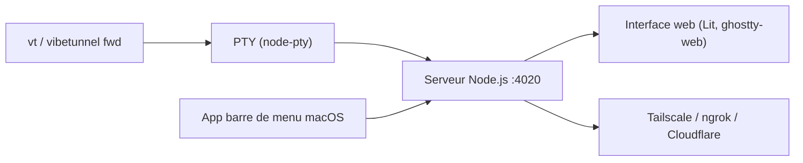

# amantus-ai/vibetunnel

> Proxy qui expose les terminaux d'un Mac ou d'un serveur dans le navigateur, pour piloter des agents à distance.

## Le problème
Surveiller un agent IA ou un long build depuis un téléphone oblige à monter SSH et la redirection de ports.

## Ce que ça fait vraiment
Un serveur Node.js (interface Lit) transmet les sessions de terminal au navigateur via la commande `vt`, avec enregistrement asciinema, indicateurs d'activité et mode Git Follow. Une application de barre de menu macOS gère le serveur. L'accès distant passe par Tailscale, ngrok, Cloudflare Quick Tunnel, Pinggy ou Pangolin.

## Comment c'est branché


## Essayer
```bash
npm install -g vibetunnel
vt pnpm run dev
vibetunnel --bind 0.0.0.0
npx -y vibetunnel --no-auth
```

## Coût et pièges
Gratuit ; l'application macOS exige un Mac Apple Silicon, le paquet npm Node 22.12 à 24.x, et Windows n'est pas pris en charge. Exposer un terminal sur le réseau est risqué : choisir une authentification, jamais `--no-auth` hors réseau de confiance. Tailscale, ngrok et les autres ont leurs propres comptes et offres.

## Ce que ce n'est pas
Ce n'est pas un client SSH sécurisé par défaut ni une solution Windows. L'application iOS est encore en cours de développement, selon le README.

## Alternatives
Tailscale, ngrok, Cloudflare Quick Tunnel, Pinggy et Pangolin sont cités comme moyens d'accès distant, pas comme concurrents.

## Pour toi
À surveiller : pratique pour suivre des agents ou des entraînements longs depuis un téléphone, mais il ouvre un accès terminal qui demande une authentification soignée.

