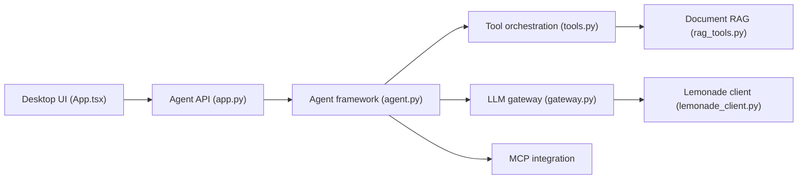

# amd/gaia

> AMD framework for building AI agents that run locally on Ryzen AI hardware, for developers.

## The problem
Running agents (RAG, voice, vision) without sending your data to the cloud or paying for inference, on consumer hardware.

## What it actually does
Base `Agent` class with tool registration (`@tool`), memory, document RAG (50+ formats), voice (Whisper + Kokoro), vision (Qwen3-VL-4B), MCP client, plugin system and agent registry. Inference goes through the Lemonade server; cloud providers (Fireworks AI, AMD LLM Gateway) are optional. A C++17 port exists in `cpp/`.

## How it is wired


## Trying it
```bash
pip install amd-gaia
```
```python
from gaia.agents.base.agent import Agent
from gaia.agents.base.tools import tool
```
The README refers to the getting-started guide for Lemonade Server.

## Cost and gotchas
Free locally. Minimum: AMD Ryzen AI 300 series processor, 16 GB of RAM (64 GB recommended), Windows 11 or Linux. Cloud chat sends the history to the chosen provider. 1,072 open issues.

## What it is not
Not a portable solution: NPU/iGPU acceleration targets AMD Ryzen AI hardware. The "HIPAA-compliant" mention is a README claim, not verified here.

## Alternatives
No alternative named in the README.

## For you
Worth watching: interesting if you have a Ryzen AI machine and want 100% local agents; otherwise the interest drops, the core value being tied to this hardware.
