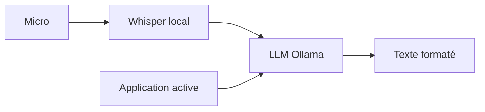

# amicalhq/amical

> Local voice dictation app built on Whisper, which adapts the text to the active application.

## The problem
Dictation tools send your voice to the cloud and format the text without considering context.

## What it actually does
Transcribes voice locally with Whisper and processes it with open-source LLMs. It detects the active application (email, Discord, IDE) to adapt the format. A floating widget, shortcuts and voice macros complete the set. Structured voice notes are in progress, while MCP integration and meeting transcription are still planned.

## How it is wired

Simplified diagram based on the sheet, no diagram provided.

## Trying it
```bash
brew install --cask amical
git clone --recurse-submodules https://github.com/amicalhq/amical.git
pnpm install --frozen-lockfile
pnpm turbo run dev --filter=@amical/desktop
```

## Cost and gotchas
Free, apart from the optional cloud. Building requires CMake, Xcode or Visual Studio, and Node 24. Local Whisper requires macOS 15 or later; Linux is not supported.

## What it is not
Not yet a meeting transcription tool or an MCP voice command tool: those points are planned. No Linux version.

## Alternatives
No alternative named in the README.

## For you
Worth watching: interesting for private dictation on Mac or Windows, but not on Linux and with several features still to come.
