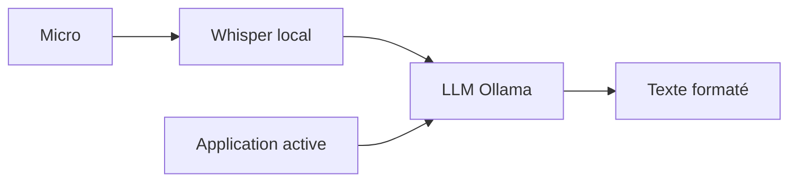

# amicalhq/amical

> Application de dictée vocale locale sous Whisper, qui adapte le texte à l'application active.

## Le problème
Les outils de dictée envoient la voix dans le cloud et formatent le texte sans tenir compte du contexte.

## Ce que ça fait vraiment
Transcrit la voix avec Whisper en local et la traite avec des LLM open source. Elle détecte l'application active (e-mail, Discord, IDE) pour adapter le format. Un widget flottant, des raccourcis et des macros vocales complètent l'ensemble. Notes vocales structurées en cours, intégration MCP et transcription de réunions encore planifiées.

## Comment c'est branché

Schéma simplifié d'après la fiche, sans diagramme fourni.

## Essayer
```bash
brew install --cask amical
git clone --recurse-submodules https://github.com/amicalhq/amical.git
pnpm install --frozen-lockfile
pnpm turbo run dev --filter=@amical/desktop
```

## Coût et pièges
Gratuit, hors cloud optionnel. La compilation exige CMake, Xcode ou Visual Studio, et Node 24. Whisper local demande macOS 15 ou plus ; Linux n'est pas pris en charge.

## Ce que ce n'est pas
Pas encore un outil de transcription de réunions ni de commande vocale MCP : ces points sont planifiés. Pas de version Linux.

## Alternatives
Aucune alternative nommée dans le README.

## Pour toi
À surveiller : intéressant pour la dictée privée sur Mac ou Windows, mais hors Linux et avec plusieurs fonctions encore à venir.

