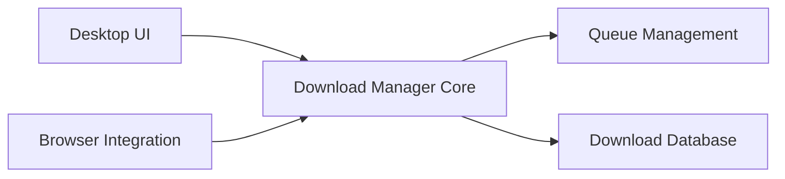

# amir1376/ab-download-manager

> Desktop download manager with queues, scheduling and browser extensions.

## The problem
Browsers handle large downloads poorly: no queue, no scheduling, no acceleration.

## What it actually does
Kotlin Multiplatform / Compose Desktop application: accelerated downloads, queues and schedulers, categories, themes, browser integration through an extension and native messaging. Windows, Linux, macOS, Android. Built-in updates.

## How it is wired


## Trying it
```bash
bash <(curl -fsSL https://raw.githubusercontent.com/amir1376/ab-download-manager/master/scripts/install.sh)
winget install amir1376.ABDownloadManager
brew tap amir1376/tap && brew install --cask ab-download-manager
```

## Cost and gotchas
Free. The README warns that any version outside the listed channels (Play Store included) is a scam. 476 open issues.

## What it is not
Not a data collection or crawling tool.

## Alternatives
No alternative named in the README.

## For you
Personal download convenience (large datasets), with no data/AI scope: ignore.
