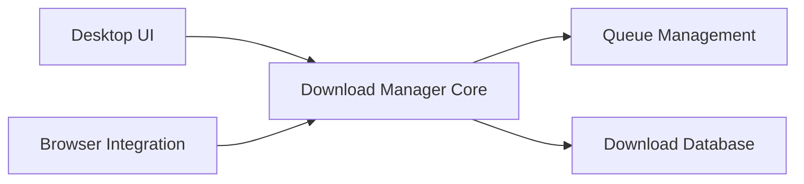

# amir1376/ab-download-manager

> Gestionnaire de téléchargements de bureau avec files, planification et extensions de navigateur.

## Le problème
Les navigateurs gèrent mal les gros téléchargements : pas de file, de planification ni d'accélération.

## Ce que ça fait vraiment
Application Kotlin Multiplatform / Compose Desktop : téléchargements accélérés, files et planificateurs, catégories, thèmes, intégration navigateur via extension et messagerie native. Windows, Linux, macOS, Android. Mises à jour intégrées.

## Comment c'est branché


## Essayer
```bash
bash <(curl -fsSL https://raw.githubusercontent.com/amir1376/ab-download-manager/master/scripts/install.sh)
winget install amir1376.ABDownloadManager
brew tap amir1376/tap && brew install --cask ab-download-manager
```

## Coût et pièges
Gratuit. Le README avertit que toute version hors des canaux listés (Play Store compris) est une arnaque. 476 issues ouvertes.

## Ce que ce n'est pas
Pas un outil de collecte de données ni de crawling.

## Alternatives
Aucune alternative nommée dans le README.

## Pour toi
Confort personnel de téléchargement (jeux de données lourds), sans portée data/IA : à ignorer.

