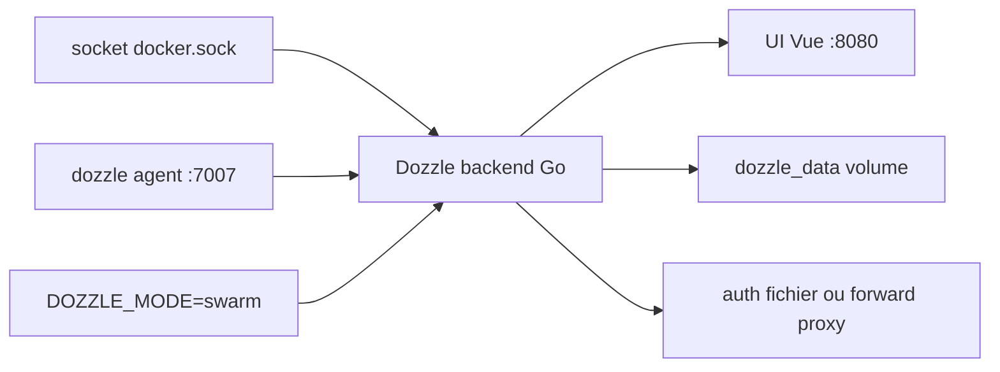

# amir20/dozzle

> Web viewer for live Docker logs, with no storage and no indexing.

## The problem
Following the logs of several containers live takes as many terminals as there are
`docker logs -f` commands, and deploying a Loki or ELK stack for that is out of proportion.

## What it actually does
Connects to the Docker socket and shows logs in real time in the browser.
Fuzzy search on container names, log search by regex or SQL queries, split screen to follow
several logs, live memory and CPU stats, dark mode. Multi-user authentication with support
for an upstream authorization proxy (Authelia). Swarm mode as a global service, and agent
mode to monitor several Docker hosts from a single interface. Automatic API version
negotiation: works with Colima and Podman.

## How it is wired


## Trying it
```bash
docker pull amir20/dozzle:latest
docker run --name dozzle -d --volume=/var/run/docker.sock:/var/run/docker.sock -v dozzle_data:/data -p 8080:8080 amir20/dozzle:latest
docker run -v /var/run/docker.sock:/var/run/docker.sock -p 7007:7007 amir20/dozzle:latest agent
```

## Cost and gotchas
Free, image of about 7 MB compressed, built `FROM scratch` so it has no shell —
`alpine` variants exist for cases that mount a `#!/bin/sh` wrapper on the entrypoint.
Docker Engine 19.03 minimum (API 1.40+). Mounting the Docker socket gives very broad access
to the daemon: do not expose it without authentication. Anonymous analytics are sent to
Google Analytics, can be disabled with `--no-analytics`. Avoid `latest` and `master` in
production, prefer an exact tag.

## What it is not
Not a centralized logging system: nothing is stored, and the README says so — no offline
search, Loggly, Papertrail or Kibana are better suited for real search. Tested with hundreds
of containers, not beyond.

## Alternatives
- `dtop`: top-style application for containers, by the same author, links to Dozzle.
- Loggly, Papertrail, Kibana: for full search and history.

## For you
Worth installing on any working Docker machine: five minutes, 7 MB, and you stop opening
terminals to read logs.
