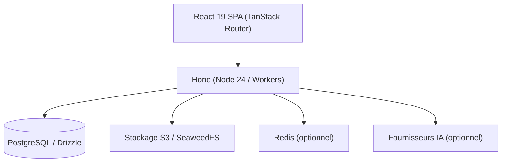

# amruthpillai/reactive-resume

> Self-hosted CV and cover letter generator, with optional AI assistant.

## The problem
Create a CV that is easily readable by recruitment software, without requiring any paid service or data tracking.

## What it actually does
Publisher with live PDF preview, 18 templates, readability checks and keyword matching, cover letters, application tracking, imports (JSON Resume, LinkedIn, PDF, Word), PDF/Word/Markdown/JSON exports, public links, REST API and MCP. Stack: React 19, Hono, PostgreSQL, Drizzle.

## How it is wired


## Trying it
```bash
git clone --depth=1 https://github.com/reactive-resume/reactive-resume.git reactive-resume
cd reactive-resume
cp .env.example .env
docker compose up -d --build
```
Then, open http://localhost:3000.

## Cost and gotchas
Free; requires two secrets to be generated (AUTH_SECRET, ENCRYPTION_SECRET). You are responsible for providing the AI vendors. Cloudflare requires Workers Paid; Hostinger starts at $6.49/month. Manual migration from v5 to v6.

## What it is not
Not a data tool. The Word import feature requires a connected AI provider.

## Alternatives
No alternative is specified in the README file.

## For you
Things to watch out for: This is not directly related to MLOps, but it can be used as a self-hosted reference application (Docker, PostgreSQL, MCP).
