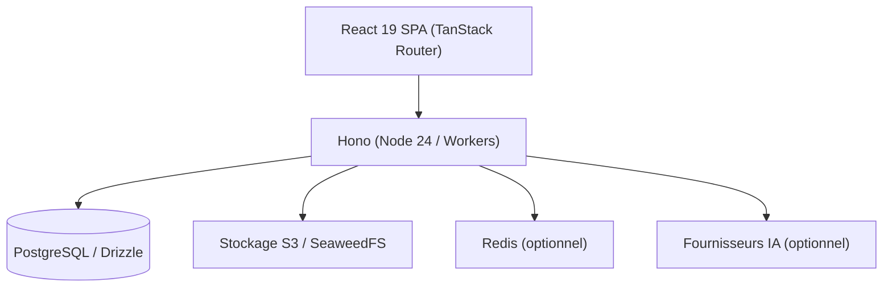

# amruthpillai/reactive-resume

> Générateur de CV et lettres de motivation auto-hébergeable, avec assistant IA optionnel.

## Le problème
Mettre en forme un CV lisible par les logiciels de recrutement, sans service payant ni suivi de tes données.

## Ce que ça fait vraiment
Éditeur avec aperçu PDF en direct, 18 modèles, contrôles de lisibilité et correspondance de mots-clés, lettres de motivation, suivi des candidatures, imports (JSON Resume, LinkedIn, PDF, Word), exports PDF/Word/Markdown/JSON, liens publics, API REST et MCP. Pile : React 19, Hono, PostgreSQL, Drizzle.

## Comment c'est branché


## Essayer
```bash
git clone --depth=1 https://github.com/reactive-resume/reactive-resume.git reactive-resume
cd reactive-resume
cp .env.example .env
docker compose up -d --build
```
Puis ouvrir http://localhost:3000.

## Coût et pièges
Gratuit ; deux secrets à générer (AUTH_SECRET, ENCRYPTION_SECRET). Les fournisseurs IA sont à ta charge. Cloudflare exige Workers Paid ; Hostinger dès 6,49 $/mois. Migration v5 vers v6 manuelle.

## Ce que ce n'est pas
Pas un outil data. L'import Word exige un fournisseur IA connecté.

## Alternatives
Aucune alternative nommée dans le README.

## Pour toi
À surveiller : sans lien avec le cœur MLOps, mais utile comme application auto-hébergée de référence (Docker, PostgreSQL, MCP).

