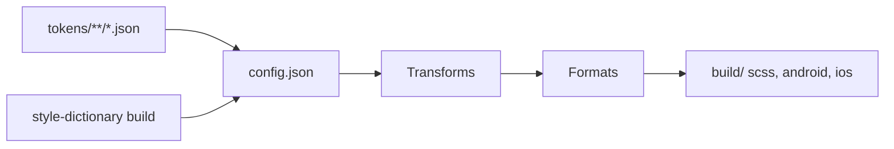

# amzn/style-dictionary

> Generates cross-platform style variables from JSON design tokens, for front-end and design teams.

## The problem
Keeping colors, sizes and styles in sync across iOS, Android, CSS and documentation.

## What it actually does
Reads token files (JSON/JS) and a `config.json`, then exports per platform via "transform groups" and formats (SCSS, Android XML, Objective-C…). Aliases between tokens are resolved (`{size.font.medium}`). Transforms and formats are customizable through `registerTransform`.

## How it is wired


## Trying it
```bash
npm install -g style-dictionary
style-dictionary init basic
style-dictionary build
```

## Cost and gotchas
Free, Node/npm required. The README examples mix `require(...).extend` and ESM imports of enums: check the installed version.

## What it is not
Not a design tool nor a token editor: it is a code generator working from files.

## Alternatives
No alternative named in the README.

## For you
Worth watching: useful if you build a design system or a UI for a data tool; otherwise marginal.
