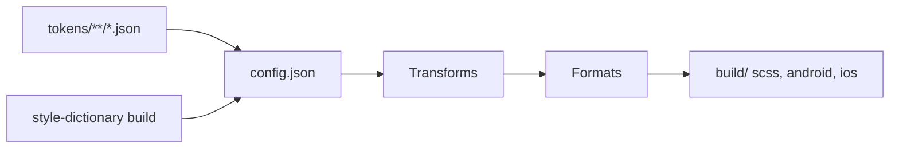

# amzn/style-dictionary

> Génère des variables de style multiplateformes depuis des design tokens JSON, pour équipes front et design.

## Le problème
Garder couleurs, tailles et styles synchronisés entre iOS, Android, CSS et documentation.

## Ce que ça fait vraiment
Lit des fichiers de tokens (JSON/JS) et un `config.json` puis exporte par plateforme via des « transform groups » et des formats (SCSS, XML Android, Objective-C…). Les alias entre tokens sont résolus (`{size.font.medium}`). Transformations et formats personnalisables par `registerTransform`.

## Comment c'est branché


## Essayer
```bash
npm install -g style-dictionary
style-dictionary init basic
style-dictionary build
```

## Coût et pièges
Gratuit, Node/npm requis. Les exemples du README mélangent `require(...).extend` et imports ESM d'enums : vérifier la version installée.

## Ce que ce n'est pas
Pas un outil de design ni un éditeur de tokens : c'est un générateur de code à partir de fichiers.

## Alternatives
Aucune alternative nommée dans le README.

## Pour toi
À surveiller : utile si tu construis un design system ou une UI pour un outil data ; sinon marginal.

