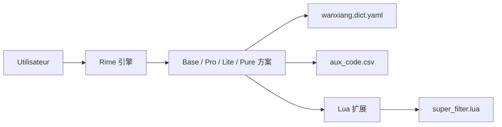

# amzxyz/rime-wanxiang

> Pinyin input schema and lexicon for the Rime engine, aimed at Chinese users.

## The problem
Typing Chinese in pinyin with good candidates, tones and a correct frequency vocabulary requires a well-tuned lexicon and rules.

## What it actually does
The repository provides Rime schemas (Base, Pro, Lite, Pure) that share a lexicon with tones and frequencies. Pro adds double pinyin with auxiliary codes, Lite is lighter, Pure works without Lua. Lua scripts provide candidate filtering, mixed Chinese-English input, custom words, a calculator and symbols. The README also describes derived projects (mobile, tiger input).

## How it is wired

## Trying it
No command documented in the provided README: installation goes through the project's documentation pages, not included here.

## Cost and gotchas
Free. You must already have a Rime front-end installed. Choosing among four versions requires reading the documentation. Pure targets Win7 and fcitx4-rime without Lua.

## What it is not
Not an input engine: it relies on Rime. README and interface in Chinese only. No link with data science.

## Alternatives
- 薄荷拼音: more complete schema that reuses the Wanxiang lexicon.
- 鸢鸣万象: mobile variant of the ecosystem.

## For you
Ignore: Chinese input tool unrelated to data, AI or MLOps, useful only if you type pinyin.
