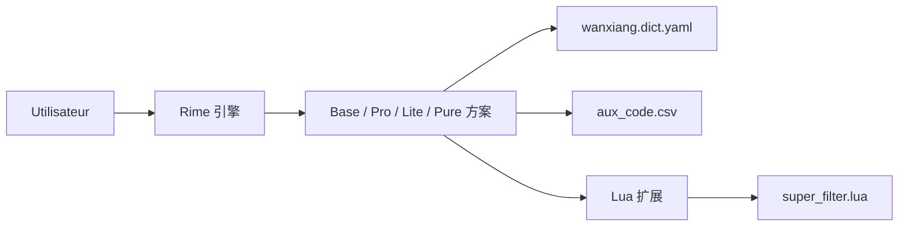

# amzxyz/rime-wanxiang

> Schéma de saisie pinyin et lexique pour le moteur Rime, destiné aux utilisateurs chinois.

## Le problème
Taper du chinois au pinyin avec de bons candidats, des tons et un vocabulaire de fréquences correct demande un lexique et des règles bien réglés.

## Ce que ça fait vraiment
Le dépôt fournit des schémas Rime (Base, Pro, Lite, Pure) qui partagent un lexique avec tons et fréquences. Pro ajoute le double pinyin avec codes auxiliaires, Lite allège, Pure fonctionne sans Lua. Des scripts Lua apportent filtrage de candidats, saisie mixte chinois-anglais, mots personnalisés, calculatrice et symboles. Le README décrit aussi des projets dérivés (mobile, saisie tigre).

## Comment c'est branché

## Essayer
Aucune commande documentée dans le README fourni : l'installation passe par les pages de documentation du projet, non incluses ici.

## Coût et pièges
Gratuit. Il faut déjà avoir un front-end Rime installé. Le choix entre quatre versions demande de lire la documentation. Pure vise Win7 et fcitx4-rime sans Lua.

## Ce que ce n'est pas
Pas un moteur de saisie : il s'appuie sur Rime. README et interface en chinois uniquement. Aucun lien avec la data science.

## Alternatives
- 薄荷拼音 : schéma plus complet qui réutilise le lexique Wanxiang.
- 鸢鸣万象 : variante mobile de l'écosystème.

## Pour toi
Ignorer : outil de saisie en chinois sans rapport avec la data, l'IA ou le MLOps, utile seulement si tu tapes du pinyin.

