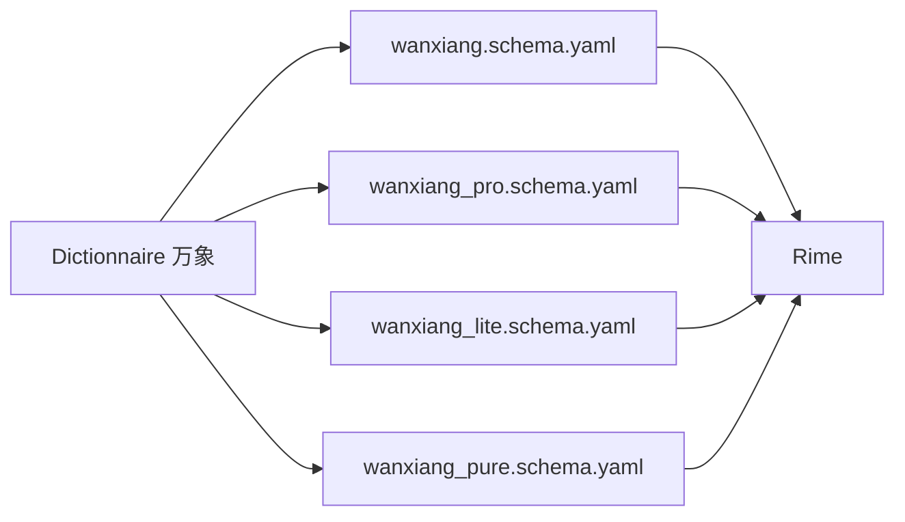

# amzxyz/rime_wanxiang

> Lexicon and pinyin input schemas for the Rime engine, aimed at Chinese users.

## The problem
Standard Rime schemas offer imprecise dictionaries (tones, frequencies) for typing whole sentences in Chinese.

## What it actually does
- Provides a dictionary with tonal pinyin, word composition and frequencies, optimized with AI and corpora, now maintained by hand.
- Four variants: Base (standard), Pro (double pinyin and auxiliary codes), Lite (lightweight), Pure (no Lua, compatibility with older systems).
- Lua extensions depending on the variant.
- Ecosystem of derived schemas (薄荷拼音, 鸢鸣万象, 李氏三拼, 万象虎).

## How it is wired

## Trying it
No command documented in the README provided; installation points to external documentation.

## Cost and gotchas
Free. Requires an installed Rime frontend; README in Chinese; CC-BY-4.0 license (attribution required), unusual for code.

## What it is not
Not a data/AI tool: it is an input method lexicon. The "grammar model" is not detailed in the README.

## Alternatives
薄荷拼音: a more complete solution using the same lexicon (cited in the README).

## For you
Ignore: without a need for pinyin input under Rime, there is nothing here for a data/AI/MLOps profile.
