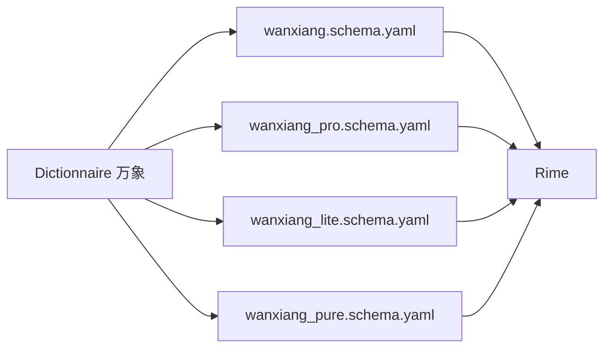

# amzxyz/rime_wanxiang

> Lexique et schémas de saisie pinyin pour le moteur Rime, destinés aux utilisateurs chinois.

## Le problème
Les schémas Rime standards offrent des dictionnaires peu précis (tons, fréquences) pour la saisie de phrases entières en chinois.

## Ce que ça fait vraiment
- Fournit un dictionnaire avec pinyin tonal, composition des mots et fréquences, optimisé par IA et corpus, désormais maintenu à la main.
- Quatre variantes : Base (standard), Pro (double pinyin et codes auxiliaires), Lite (allégée), Pure (sans Lua, compatibilité anciens systèmes).
- Extensions Lua selon la variante.
- Écosystème de schémas dérivés (薄荷拼音, 鸢鸣万象, 李氏三拼, 万象虎).

## Comment c'est branché

## Essayer
Aucune commande documentée dans le README fourni ; l'installation renvoie à la documentation externe.

## Coût et pièges
Gratuit. Requiert un frontend Rime installé ; README en chinois ; licence CC-BY-4.0 (attribution requise), peu usuelle pour du code.

## Ce que ce n'est pas
Pas un outil data/IA : c'est un lexique de méthode de saisie. Le « modèle de grammaire » n'est pas détaillé dans le README.

## Alternatives
薄荷拼音 : solution plus complète utilisant le même lexique (citée dans le README).

## Pour toi
Ignorer : sans besoin de saisie pinyin sous Rime, rien à en tirer pour un profil data/IA/MLOps.

