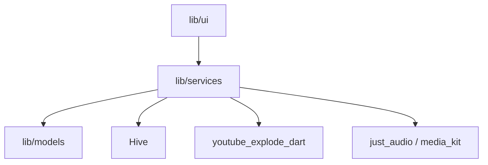

# anandnet/Harmony-Music

> Flutter music streaming app via YouTube Music, for Android, Windows and Linux — no longer maintained.

## The problem
Listening to YouTube Music without ads or an account, on several platforms.

## What it actually does
Playback of YouTube/YouTube Music tracks, cache, radio, playlists, download, equalizer, Android Auto, synced lyrics (LRCLIB), Piped playlist integration. Audio players: just_audio (Android), media_kit (Linux/Windows); Hive offline storage; track URLs via `youtube_explode_dart`.

## How it is wired

## Trying it
No documented command (the README points to APK downloads).

## Cost and gotchas
Free. Depends on an unofficial third-party service (YouTube): risk of breakage and of non-compliance with the terms of use.

## What it is not
The README states "This repository is no longer maintained". A learning project, not affiliated with content providers.

## Alternatives
No alternative named in the README.

## For you
Ignore: abandoned, outside your field, and fragile by design.
