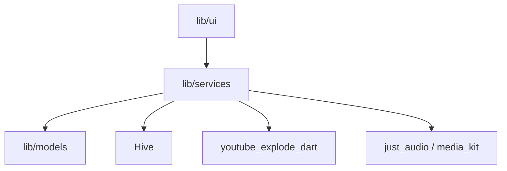

# anandnet/Harmony-Music

> Application Flutter de streaming musical via YouTube Music, pour Android, Windows et Linux — plus maintenue.

## Le problème
Écouter YouTube Music sans publicité ni compte, sur plusieurs plateformes.

## Ce que ça fait vraiment
Lecture de morceaux YouTube/YouTube Music, cache, radio, playlists, téléchargement, égaliseur, Android Auto, paroles synchronisées (LRCLIB), intégration de playlists Piped. Lecteurs audio : just_audio (Android), media_kit (Linux/Windows) ; stockage hors-ligne Hive ; URL des morceaux via `youtube_explode_dart`.

## Comment c'est branché

## Essayer
Aucune commande documentée (le README renvoie à des téléchargements APK).

## Coût et pièges
Gratuit. Dépend d'un service tiers non officiel (YouTube) : risque de casse et de non-conformité aux conditions d'usage.

## Ce que ce n'est pas
Le README annonce « This repository is no longer maintained ». Projet d'apprentissage, non affilié aux fournisseurs de contenu.

## Alternatives
Aucune alternative nommée dans le README.

## Pour toi
À ignorer : abandonné, hors métier, et fragile par construction.

