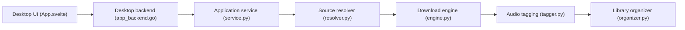

# anandprtp/Antra

> Desktop application that turns streaming service links into a tagged local music library.

## The problem
Rebuilding a clean local library (FLAC, MP3...) by hand from streaming links: metadata, covers, lyrics, organization.

## What it actually does
- Takes a link, fetches the metadata, resolves an audio source, downloads.
- Tags the file (title, artist, album, cover, genre, lyrics) and files it under `Artist / Album`.
- Outputs FLAC, ALAC, AAC, MP3; compatible with Navidrome, Jellyfin, Plex.
- Code: Svelte/Wails (Go) interface plus a Python service with a download engine.

## How it is wired

## Trying it
No documented command: download the binary from the Releases (Antra.exe, .dmg, .AppImage), choose the folder and format, paste a link, "Add to Library".

## Cost and gotchas
Free, no API key mentioned. Windows Defender may flag the binary (the README calls it a false positive).

## What it is not
Neither a player nor a media server. The README shifts legal responsibility to the user: retrieving audio from streaming services may violate their terms. The exact origin of the audio sources is not documented.

## Alternatives
No alternative named in the README.

## For you
Ignore: a consumer tool unrelated to data/AI/MLOps work, with real legal risk and an unidentified license.
