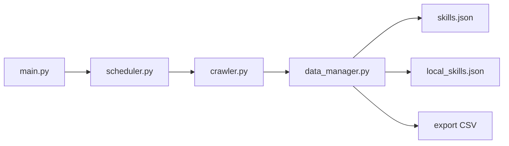

# anbeime/skill

> Catalog of AI agent skills, mostly in Chinese, with an automatic update script.

## The problem
Finding, among thousands of agent skills, the ones worth installing.

## What it actually does
Aggregates 182 "official" skills scraped from awesome-agent-skills and 63 local skills (content, video, e-commerce, PPT, voice), exportable as JSON or CSV. `main.py` runs a one-off or daemon update, plus a `SKILL.md` validator. The end of the README is a long list of repository names, and it is cut off in the middle of the ClawHub section.

## How it is wired


## Trying it
```bash
git clone https://github.com/anbeime/skill.git
cd skill
pip install -r requirements.txt
python main.py --once
python main.py --stats
python main.py --export skills.csv
```

## Cost and gotchas
Free. The catalog declares no license while the README claims "MIT License": a contradiction to check. Several skills require third-party APIs (15 "API required" according to the sample JSON). The README contains personal Windows paths (`D:\tool\skills\`) and contact details.

## What it is not
Not a reliable source of vetted skills: it is an aggregate, with promotional sections (product "知易智能基座", WeChat groups).

## Alternatives
- VoltAgent/awesome-agent-skills: the upstream source this repository scrapes.

## For you
Ignore: a mostly Chinese aggregate, oriented toward content and e-commerce, with no clear license; go straight to the upstream source.
