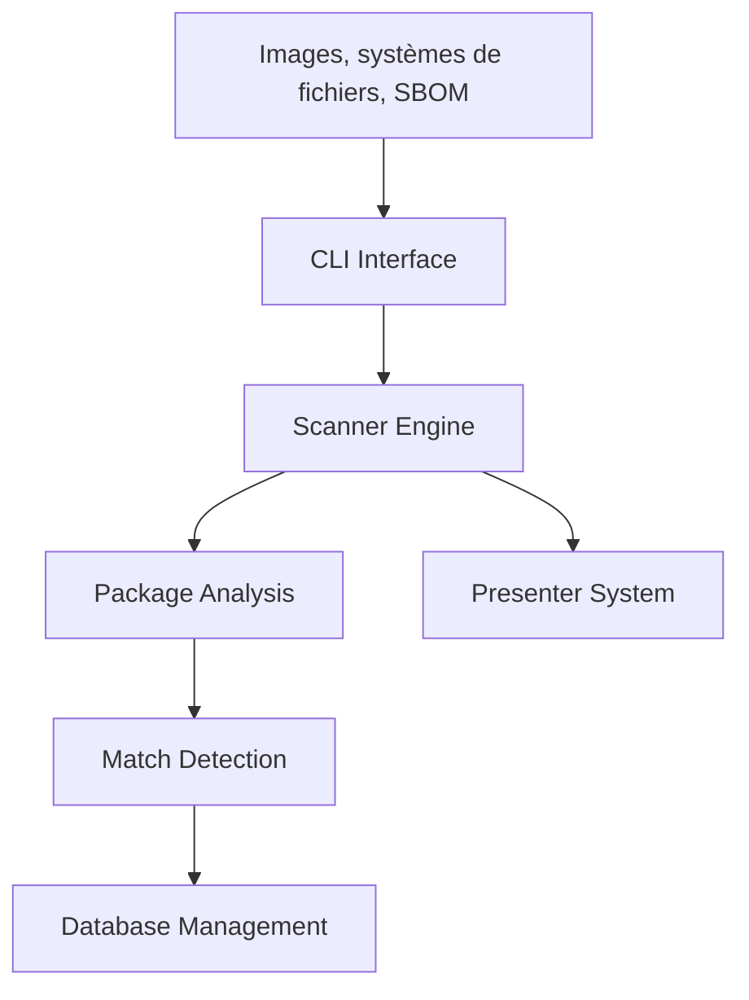

# anchore/grype

> Vulnerability scanner for container images, filesystems and SBOMs, for security and DevOps teams.

## The problem
Knowing which known vulnerabilities are hiding in an image or a project before shipping it.

## What it actually does
Scans images (Docker, OCI, Singularity), directories and SBOMs, compares the packages (system and language) against a local vulnerability database, then prioritizes with EPSS, KEV and a risk score. Supports OpenVEX to filter results. Outputs: table, JSON, SARIF, CycloneDX, custom template. The database exists in several schemas (v3 to v6).

## How it is wired


## Trying it
```bash
curl -sSfL https://get.anchore.io/grype | sudo sh -s -- -b /usr/local/bin
grype alpine:latest
grype ./my-project
grype sbom:./sbom.json
```

## Cost and gotchas
Free. Downloading the vulnerability database requires network access on first run. The install script is to be run with `sudo`: read it first.

## What it is not
Not an intrusion tool: it detects already published vulnerabilities, it does not prove they are exploitable in your setup. It does not generate the SBOM itself.

## Alternatives
Syft produces the SBOMs that Grype consumes (complement named in the README).

## For you
Worth adopting: a standard building block for scanning the images of your MLOps pipelines, easy to integrate in CI.
