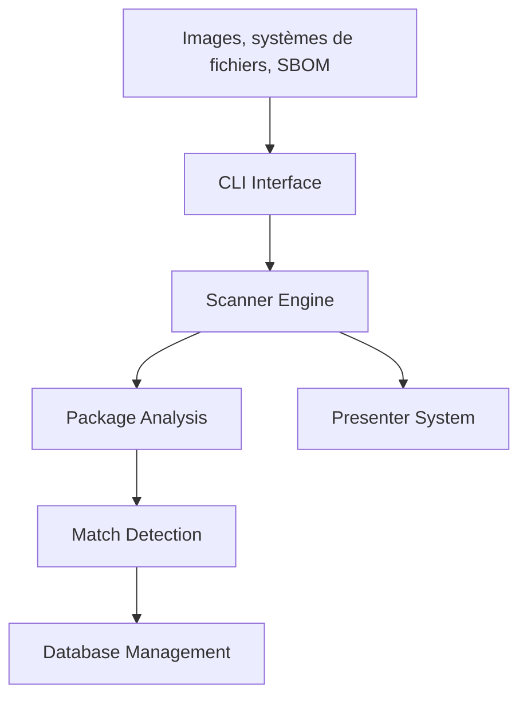

# anchore/grype

> Scanner de vulnérabilités pour images de conteneurs, systèmes de fichiers et SBOM, pour équipes sécurité et DevOps.

## Le problème
Savoir quelles vulnérabilités connues se cachent dans une image ou un projet avant de le livrer.

## Ce que ça fait vraiment
Analyse images (Docker, OCI, Singularity), répertoires et SBOM, compare les paquets (systèmes et langages) à une base de vulnérabilités locale, puis priorise avec EPSS, KEV et un score de risque. Supporte OpenVEX pour filtrer les résultats. Sorties : tableau, JSON, SARIF, CycloneDX, modèle personnalisé. La base existe en plusieurs schémas (v3 à v6).

## Comment c'est branché


## Essayer
```bash
curl -sSfL https://get.anchore.io/grype | sudo sh -s -- -b /usr/local/bin
grype alpine:latest
grype ./my-project
grype sbom:./sbom.json
```

## Coût et pièges
Gratuit. Le téléchargement de la base de vulnérabilités nécessite l'accès réseau au premier lancement. Le script d'installation est à exécuter avec `sudo` : lis-le avant.

## Ce que ce n'est pas
Pas un outil d'intrusion : il détecte des vulnérabilités déjà publiées, il ne prouve pas qu'elles sont exploitables chez toi. Il ne génère pas le SBOM lui-même.

## Alternatives
Syft produit les SBOM que Grype consomme (complément nommé dans le README).

## Pour toi
À adopter : brique standard pour scanner les images de tes pipelines MLOps, simple à intégrer en CI.

