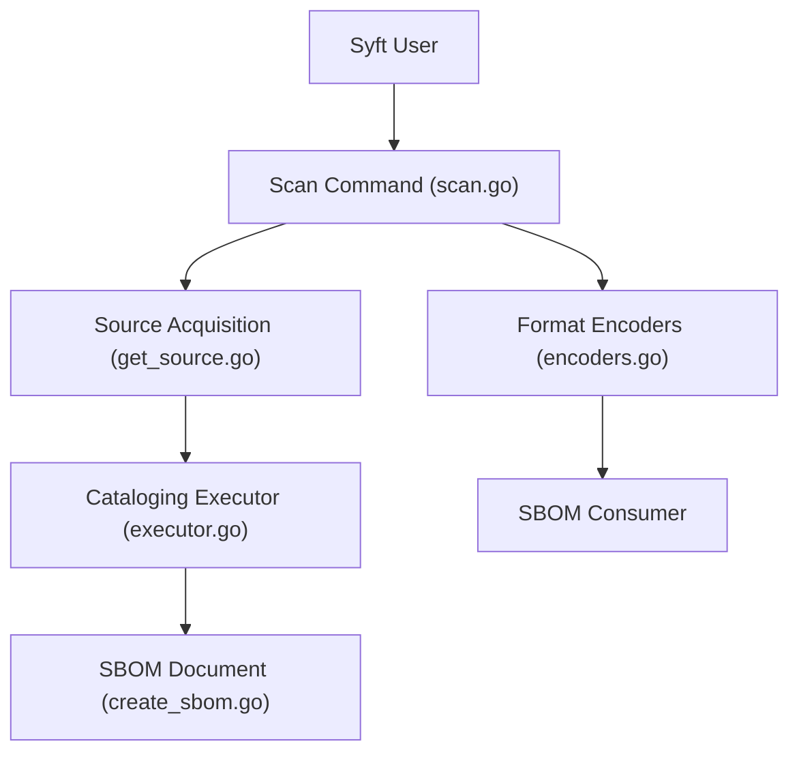

# anchore/syft

> Outil CLI et bibliothèque Go qui génère un SBOM à partir d'images de conteneurs et de systèmes de fichiers.

## Le problème
Impossible d'auditer ou de scanner ce qui est installé dans une image sans inventaire fiable des paquets.

## Ce que ça fait vraiment
Détecte les paquets de dizaines d'écosystèmes (apk, dpkg, RPM, Go, Python, Java, JavaScript, Rust…) dans des images OCI, Docker, Singularity, des répertoires et des archives. Exporte en CycloneDX, SPDX ou JSON Syft, convertit entre formats et crée des attestations signées (in-toto). Fonctionne de pair avec Grype pour la détection de vulnérabilités.

## Comment c'est branché


## Essayer
```bash
curl -sSfL https://get.anchore.io/syft | sudo sh -s -- -b /usr/local/bin
syft alpine:latest
syft <image> -o cyclonedx-json
syft <image> -o spdx-json=./spdx.json -o cyclonedx-json=./cdx.json
```

## Coût et pièges
Gratuit. Le script d'installation passe par `sudo` : à lire avant. Pour scanner des images locales Podman, il faut `--from containers-storage`.

## Ce que ce n'est pas
Pas un scanner de vulnérabilités : il fait l'inventaire, c'est Grype qui évalue les failles.

## Alternatives
Grype, du même éditeur, prend le relais pour les vulnérabilités (complément, pas concurrent).

## Pour toi
À adopter : étape de base pour la chaîne d'approvisionnement logicielle de tes images ML, facile à brancher en CI.

