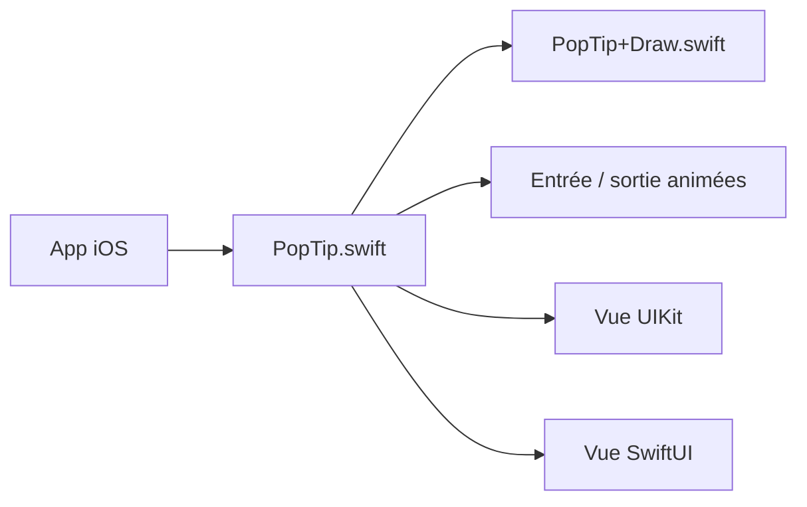

# andreamazz/AMPopTip

> iOS Swift library that displays animated bubbles with an arrow, to guide the user through the interface.

## The problem
Showing a tooltip anchored to an iOS screen element, with direction, arrow and animation, takes a lot of UIKit drawing and positioning code.

## What it actually does
A `PopTip` class displays text, a UIKit view or a SwiftUI view (via `UIHostingController`) in a bubble pointing at a frame. Fixed or automatic direction, background mask with cutout, entry and action animations, gestures (tap, swipe, outside tap) with callbacks. Styling goes through the appearance proxy or public properties.

## How it is wired


## Trying it
```bash
pod install
carthage update
```
```swift
let popTip = PopTip()
popTip.show(text: "Hey! Listen!", direction: .up, maxWidth: 200, in: view, from: someView.frame)
```
(The README asks you to add `pod 'AMPopTip'` to the Podfile, or `github "andreamazz/AMPopTip"` to the Cartfile.)

## Cost and gotchas
Free, no service. The frame you provide must be in the absolute coordinate space of the presenting view (conversion with `convertRect(_:toView:)`). A parent view that is too small clips the bubble: set `clipsToBounds = false` and `constrainInContainerView = false`.

## What it is not
Not a complete onboarding flow solution: it is a single bubble at a time. iOS only (Swift 4.2+ stated). No mention of Swift Package Manager in the README. Last push in March 2024.

## Alternatives
No alternative named in the README.

## For you
Ignore: outside your data/AI/MLOps domains (iOS mobile UI), and the repo has not moved in over a year; useful only if you develop in Swift.
