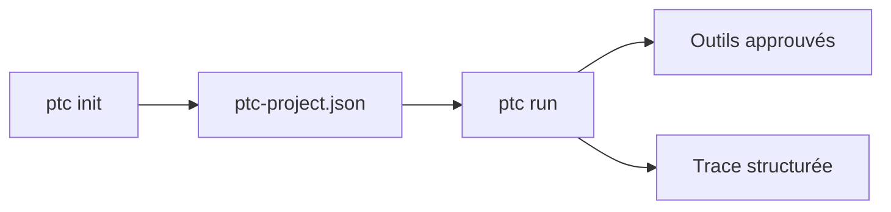

# andreasronge/ptc_runner

> Language and runtime for agents: bounded loops that verify their work, for agent developers.

## The problem
Agents launched without bounds or traces are hard to verify and to fix when they fail.

## What it actually does
PtcRunner offers a small typed language, limited to approved tools discovered in a REPL, and a runtime for agent services: bounded, traceable tasks, many concurrent requests, no desktop or container per agent. The `ptc` command creates and runs projects, with no API key for the example, and leaves a structured trace.

## How it is wired
Simplified diagram based on the sheet, no diagram provided.



## Trying it
```console
ptc init hello-ptc
ptc run hello-ptc/ptc-project.json
```

## Cost and gotchas
Standalone archive for macOS arm64, container image for Linux AMD64 and ARM64. Project at version 0.x: the README announces breaking changes. The costs of a real model are not specified.

## What it is not
Not a stable framework: the README speaks of active development. The example does not show a call to a language model.

## Alternatives
No alternative named in the README.

## For you
Worth watching: an interesting approach for bounded, traceable agents, but at 0.x with a single maintainer; retest before any serious use.
